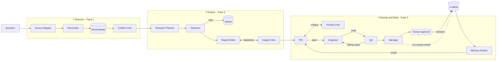

# AgentOffice

**A simulated AI office team. It finds where an office team's time goes, explains why with evidence, and then decides on, builds and tests the automation that fixes it. A human approves before anything goes live.**

This is our Open Agent Hackathon 2026 submission. The primary track is **Track 3, Reasoning Architecture**. Stages 1 and 2 also address Track 1 (Fragmented Intelligence) and Track 2 (Explain Why).

> **Status (25 Oct 2026):** all three stages run end to end in both **sample mode** and **default mode against Meterless Nightshift** (NVIDIA Nemotron). Live traces and outputs are saved to `output_examples/`. Zetaris tables are loaded and verified on live Zetaris REST endpoints. See [Done vs not yet](#done-vs-not-yet).

## What it does

You ask a question such as *"Where is the finance team losing time, and what should we automate first?"*. Thirteen agents with distinct roles then work in three stages. They all read from and write to one shared **World Model**, and they carry lessons and human decisions from one run to the next in **H-MEM**.



| Stage | Agent | What it does | Model call? |
|---|---|---|---|
| 1 Discover | **Source Mapper** | Picks tables and join keys from the catalog, then probes each table | yes |
| | **Reconciler** | Links the same task across timesheets, tickets and activity routines, and writes people (by ID only), teams, tasks, tools and their links | yes |
| | **Conflict Critic** | Reads the conflicts the World Model surfaces (sources that disagree about the same fact) and judges which source to trust for what | yes |
| 2 Explain | **Research Planner** | Splits the question into 2–4 sub-questions | yes |
| | **Retriever** | Writes one guarded, read-only SQL query per sub-question. SQL errors go back to the model to fix (a bounded tool-use loop) | yes |
| | **Report Writer** | Drafts claims and must cite the exact result cell behind every number | yes |
| | **Insight Critic** | Checks every citation against the returned rows, plus a model wording review. Objections go back for revision, and unsupported claims are dropped | yes + rules |
| 3 Build | **PM** | Ranks the mined routines by hours saved versus risk and writes a structured automation **spec** | yes |
| | **Priority Critic** | Rejects claims above the hands-on time the activity log measures, and risk ratings below the evidence | rules |
| | **Engineer** | Writes Python from the spec, and revises using QA's failing cases | yes |
| | **QA** | Tests the code in a sandbox against expectations **computed from the spec, never from the code**, plus model-designed cases and an advisory code review | yes + rules |
| | **Manager** | Writes the decision memo behind a rule gate, then requests human approval bound to the exact code hash. It never re-submits code a human already rejected; it escalates instead | yes + rules |
| memory | **Memory Keeper** | Recalls memories for each candidate routine at the start of the build stage, passes the human decisions on record to the PM and Manager, and mines the run's events (QA verdicts, critiques, trust decisions, outcome) into H-MEM | yes |

The loops are real and capped:
- Priority Critic → PM: 2 rounds.
- QA → Engineer: 3 revisions.
- Insight Critic → Report Writer: 2 rounds.
- Retriever SQL fix: 3 attempts.
- Model calls: at most 40 per run.

Every step is written to `logs/trace-<run_id>.jsonl`, a hash-chained log in which any edited or deleted line breaks the chain.

### Why QA can't simply agree with the code

The PM writes the automation as a spec in a small DSL, not as free text: a record matcher with key normalization, ordered checks and statuses ([`app/automation/spec.py`](app/automation/spec.py)). The spec has exact semantics, so QA builds its expected outputs from the spec alone ([`oracle.py`](app/automation/oracle.py)):

- every status branch, plus check precedence
- key-normalization variants (case and whitespace)
- empty and ambiguous keys
- values just inside and just outside numeric tolerances
- seeded random mixes
- a **renamed column**, which correct code must reject loudly

It then runs the code in a sandbox ([`sandbox.py`](app/automation/sandbox.py)):
- An AST policy allows only whitelisted stdlib imports, with no `eval`/`open`/reflection/dunder access.
- The code runs in a `python -I` subprocess with an **empty environment** and a timeout.

## Sponsor technology

### Zetaris (data layer)
All agent SQL goes through [`app/adapters/zetaris.py`](app/adapters/zetaris.py). It follows the REST contract (`/sql-editor/sqls/run`, Bearer key, `X-Org-ID`, a fresh UUID `X-Request-ID`), sends one statement per call, and retries only read-only statements, with timeouts and structured errors.

Zetaris can't read local files, so the API serves each synthetic table as JSON (`GET /data/workforce/<table>`). [`scripts/load_zetaris.py`](scripts/load_zetaris.py) registers those endpoints as **Lightning REST tables**. It's a dry run by default; `--apply` runs one statement at a time and verifies row counts.

The agents write `workforce.<table>`. The adapter rewrites each reference to read its REST table, `(SELECT r.* FROM workforce_api.<table> LATERAL VIEW explode(rows) AS r)`, so no views or other extra objects are needed. The trace records the SQL that actually ran.

**We verified this on a local Zetaris 2.4.3 install:**
- All 6 statements succeed, and every row count matches the generator's manifest.
- The pipeline's 15 queries run on Zetaris, and the findings are identical to sample mode.

### Meterless
- **Power rule.** Nightshift is the **primary model provider** ([`app/adapters/meterless.py`](app/adapters/meterless.py)). It follows the provider contract:
  - provider `meterless` / "Meterless Runtime"
  - pasted URLs normalized to `<host>/v1`, and the `rt-local` placeholder rejected
  - a `meterless-app` header on every request, and `meterless-scope: user` on chat
  - status from `GET /v1/models` (online, unauthorized or offline)
  - auto-detect across ports 8088/8090/8787/11434
  - connect links (`/connect#k=`)
  - a 180-second timeout

  To test the connection, use `GET /providers/meterless` or `scripts/check_connections.py --detect`.
- **Build rule: World Model engine** ([`app/engines/world_model/`](app/engines/world_model/)). We wrote it from scratch in Python, following the Meterless reference design:
  - content-hash stable IDs (`ent_` + sha256 of `type:normalized name`)
  - an append-only observation log, with provenance back to source rows required
  - a 10-step idempotent ingest: reconcile → cluster → persist → score → infer → edges → views → patch source items → aggregates → mark stale
  - canonical reconstruction (latest, union, longest text, most confident, provenance-weighted)
  - merge proposals that are never applied automatically
  - a structured, budgeted context builder

  It's in a working user-facing feature: every stage reads its context from it and writes what it learns back. Stage 1's source conflicts *are* the World Model's conflict records. 18 tests cover the engine, including:
  - re-ingest yields an empty diff
  - resume after a crash
  - 10 concurrent writers match a serial run
- **Second engine: H-MEM** ([`app/engines/hmem/`](app/engines/hmem/)). We wrote it from scratch, following the Meterless H-MEM reference contract:
  - **Records:** the reference fields, the four types (personal, factual, preference, general) and the three layers (short_term, working, long_term). A record with no source is rejected by construction.
  - **Approval boundary:** a programmable `ApprovalPolicy` decides which proposals become durable memory.
  - **Reinforcement:** proposing the same memory again raises its confidence by 0.05 and promotes it one layer.
  - **Conflicts:** detected by opposing phrases, conflicting numbers or divergent claims about the same entity. They're auto-resolved only at decision confidence ≥ 0.70; the loser gets `supersededBy` and is never deleted. Anything less certain is tagged for human review.
  - **Retrieval:** the reference's 8-signal formula, `clamp01(0.35 semantic + 0.20 keyword + 0.10 tag + 0.10 domain + 0.15 entity + 0.05 layer + 0.05 recency − 0.20 superseded) × confidence`, with a 0.35 threshold and the top 5, returned with a `retrievalReason` for each memory.
  - **Audit:** an append-only, hash-chained trust ledger in `logs/hmem-ledger*.jsonl`.

  **What it changes:** when a human rejects an automation, the next run proposes a different routine. If there's no alternative, the Manager escalates the identical rejected code instead of asking again. The Engineer's prompt carries QA lessons from earlier runs. 16 tests cover the engine, including this three-session behaviour: learned → retrieved → behaved differently.

### NVIDIA
Nemotron runs through Nightshift lanes; no local GPU is used. *We haven't yet pinned the exact Nemotron `meterless/*` route, because Nightshift isn't configured yet.* Every model call's trace records the model that actually answered.

## Quick start (Windows PowerShell)

```powershell
python -m venv .venv
.\.venv\Scripts\python.exe -m pip install -r requirements-dev.txt
.\.venv\Scripts\python.exe -m pytest -q
```

**Sample mode** needs no keys and no network. It runs the real agent logic on the committed synthetic data, and needs no `.env` file.

```powershell
.\.venv\Scripts\python.exe scripts\run_examples.py --sample
```

Or start the API and call it yourself:

```powershell
$env:SAMPLE_MODE = "true"; .\.venv\Scripts\python.exe run.py
```

```bash
curl -X POST http://localhost:8000/run -H "Content-Type: application/json" -d @input_examples/example_1.json
```

**Default mode** needs a running Zetaris instance and Meterless Nightshift; see [docs/PROJECT_PLAN.md §6](docs/PROJECT_PLAN.md).

1. Copy `.env.example` to `.env` and fill in your values. Never commit `.env`.
2. Check both services:
   ```powershell
   .\.venv\Scripts\python.exe scripts\check_connections.py --detect
   ```
3. Register the data in Zetaris (dry run first, then `--apply`):
   ```powershell
   .\.venv\Scripts\python.exe scripts\load_zetaris.py
   ```
4. Run the examples:
   ```powershell
   .\.venv\Scripts\python.exe scripts\run_examples.py
   ```

**Docker** (the image targets Python 3.11):

```bash
docker build -t oah-submission .
docker run --rm -p 8000:8000 --env-file .env oah-submission
```

Without keys, run sample mode with `docker run --rm -p 8000:8000 -e SAMPLE_MODE=true oah-submission`.

Inside the container, `localhost` would mean the container itself. So `localhost`/`127.0.0.1` URLs in `.env` are rewritten to `host.docker.internal`, where Zetaris and Nightshift run. `GET /health` shows the effective addresses, and `AGENTOFFICE_NO_HOST_REWRITE=true` turns the rewrite off.

## API

| Endpoint | Purpose |
|---|---|
| `POST /run` | `{"request_id", "user_query", "context", "options": {"sample_mode", "stages": ["discover", "explain", "build"]}}`. Returns `agents_used`, `result{summary, findings, confidence, ranking, decision, automation}`, `collaboration{feedback_loop_completed, revision_count, evaluator_findings, …}`, `stages`, `approval`, `log_path` and `execution_time_seconds`. Failures return `{status: "error", error{type, message, recoverable}, trace_id}`. |
| `GET /approvals/{id}` / `POST /approvals/{id}` | The human approval gate: `{"decision": "approve" \| "reject", "approver", "note", "code_hash"}`. It's hash-chained and bound to the code hash. The decision also becomes a long-term H-MEM preference that later runs respect. Approving only records the decision; nothing is deployed. |
| `GET /providers/meterless` | Test Connection for the primary provider. The token is never returned. |
| `GET /data/workforce/{table}` | Serves the synthetic tables for Zetaris REST tables. |
| `GET /health` | Configuration status. No external calls. |

## Examples

[`input_examples/`](input_examples/) holds three questions, about Finance, Operations and Sales. [`output_examples/sample_mode/`](output_examples/sample_mode/) holds the **real responses and traces from sample-mode runs**; the app never reads them. Different questions give different results:

| Example | Chosen automation | QA |
|---|---|---|
| Finance: where are we losing time? | `invoice_po_matcher` (about 23 h/week, high risk) | 22/22 cases |
| Operations: what repetitive work is eating the week? | `order_status_responder` (about 6.2 h/week, medium risk) | 19/19 cases |
| Sales: is CRM data entry worth automating? | `lead_contact_deduper` (about 5.4 h/week, medium risk) | 22/22 cases |

*Default-mode outputs (Zetaris + Nemotron) will be added once those services are running.*

## Sample mode and fallbacks

`SAMPLE_MODE=true` (or `options.sample_mode`) loads the committed synthetic CSVs into SQLite under the same `workforce` schema name, so the agents' SQL runs unchanged. In this mode:
- Every Zetaris call is logged as `zetaris: skipped (sample mode)`.
- No model is called. Each agent uses its own deterministic, data-driven fallback, logged as `model: offline-fallback`:
  - The PM ranks by measured hours and uses a built-in spec template.
  - The Engineer compiles the spec.
  - The writer cites cells from fixed queries.
- QA, the Priority and Insight Critics' rule checks, the sandbox and the World Model run exactly as in default mode.

Sample mode returns no saved answers.

## Data

All the data is **synthetic** and generated by a committed, deterministic script; see [data/README.md](data/README.md). The people and events are invented, and emails use `example.com`. Agents refer to people by `person_id` only, and a test checks that no name reaches any prompt.

## Repository map

```
app/adapters/       zetaris.py, meterless.py, http.py (timeouts, bounded retries, structured errors)
app/engines/world_model/   Meterless World Model engine (store, 10-step ingest, context builder)
app/engines/hmem/   Meterless H-MEM engine (store + approval policy + conflicts, retrieval, mining, trust ledger)
app/agents/         base.py (traced model + data calls), stage1.py, stage2.py, stage3.py, memory.py
app/automation/     spec DSL, QA oracle, sandbox, offline compiler
app/analysis/       routine mining from the activity log
app/data.py         data-layer seam (Zetaris / sample SQLite)
app/approvals.py    hash-chained human approval ledger
app/pipeline.py     the three-stage run
run.py              FastAPI on 0.0.0.0:$PORT
scripts/            check_connections, load_zetaris, generate_workforce_data, run_examples
```

## Done vs not yet

| Done (tested) | Not yet |
|---|---|
| Three stages, 13 agents, real critique and revision loops (tested with a scripted model test double) | Pinning a Nemotron `meterless/*` route for the NVIDIA award |
| Meterless Nightshift live default-mode runs (connected, reasoning stripped, live traces in `output_examples/`) | H-MEM dreaming and sleep consolidation (not built) |
| World Model engine, wired into every stage | Docker → Nightshift reachability (in progress) |
| H-MEM engine: cross-run memory that changes later decisions | |
| Meterless provider contract, connection check, auto-detect | |
| Zetaris: tables loaded and verified; every pipeline query runs on live Zetaris with results identical to sample mode | |
| Sample mode from an empty `.env`; Docker image built from a fresh clone, 152 tests passing on Python 3.11 inside it, with no `.env` and no network keys (AGENTS.md §16) | |
| Sandbox, QA oracle, approvals, hash-chained traces | |

## Known limitations

- **The sandbox on Windows** has no memory limit (no `rlimit`), so the timeout and the static AST policy are the guards there. POSIX and Docker add CPU and memory limits.
- **The Priority Critic** treats hands-on time measured in the activity log as the ceiling on hours saved. That's conservative, and it's an assumption.
- **Confidence** comes from a stated heuristic formula (shown in each response), not from calibrated probabilities.
- **Token budgets** use the `ceil(chars / 4)` heuristic.
- **The Insight Critic** accepts a number only if it equals a cited value, or a ratio or percentage of two cited values. Integers up to 10 always pass. Otherwise valid derived numbers must be computed in SQL.
- **World Model aliases** apply to mentions made after they're registered; similar names become merge proposals and are never merged automatically.
- **Agent SQL** must stay within a portable subset (documented in `app/data.py`) so that it runs on both Zetaris and SQLite.
- **H-MEM's semantic signal** is the cosine of hashed bag-of-words and bigram vectors, not a neural embedding, so no embedding model is needed. Paraphrases with no shared words score low.
- **H-MEM dreaming and sleep consolidation** aren't built. Layers are promoted only by reinforcement.
- **Mined lessons** start as `short_term` at confidence 0.6–0.8, so they usually fall below the 0.35 retrieval threshold until they're reinforced across runs. Human decisions are `long_term` and are always applied, by exact lookup, not by ranking.

## Tools, libraries and disclosures

- **Models:** Meterless Nightshift (primary; NVIDIA Nemotron lanes). Any OpenAI-compatible endpoint can be used as a secondary provider (`LLM_PROVIDER=openai_compatible`).
- **Agent framework:** none. The agents are plain Python written for this project.
- **Libraries:**
  - FastAPI (MIT)
  - Uvicorn (BSD-3-Clause)
  - httpx (BSD-3-Clause)
  - python-dotenv (BSD-3-Clause)
  - pytest (MIT, development only)
- **Open-source code adapted:** none. Design ideas, not code, are listed in [docs/INSPIRATION.md](docs/INSPIRATION.md). The World Model follows the Meterless reference *design*, reimplemented.
- **Pre-existing components:** none. All code was written in this repository from 23 Oct 2026.
- **AI coding tool:** developed with **Claude Code** (Anthropic). All AI-generated code is reviewed and tested by the team.

The hackathon brief and agent rules are in [AGENTS.md](AGENTS.md), and the plan is in [docs/PROJECT_PLAN.md](docs/PROJECT_PLAN.md). The sponsor technology explanation is in [docs/SPONSOR_TECH.md](docs/SPONSOR_TECH.md), and the demo script is in [docs/DEMO_SCRIPT.md](docs/DEMO_SCRIPT.md).
