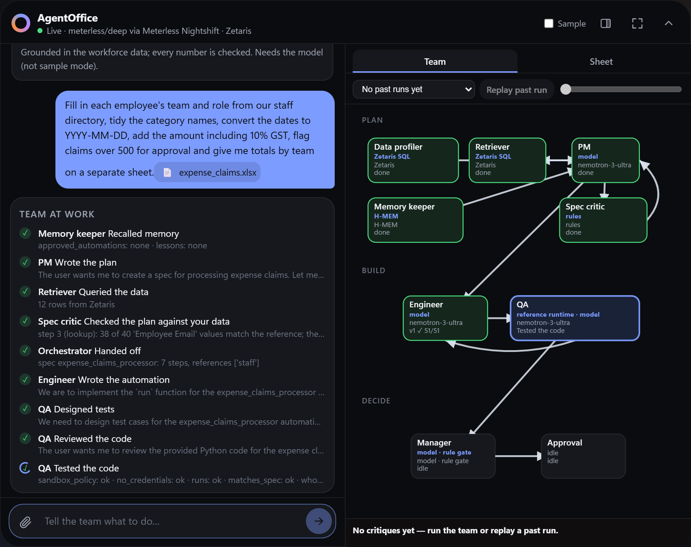
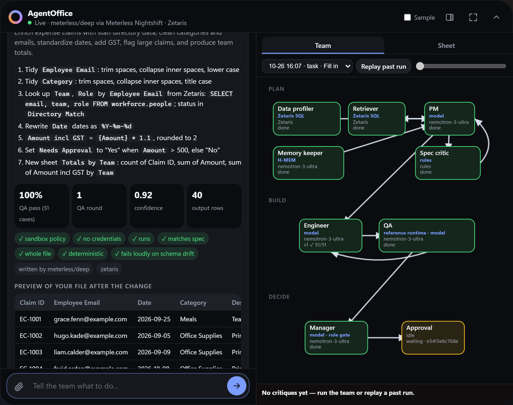
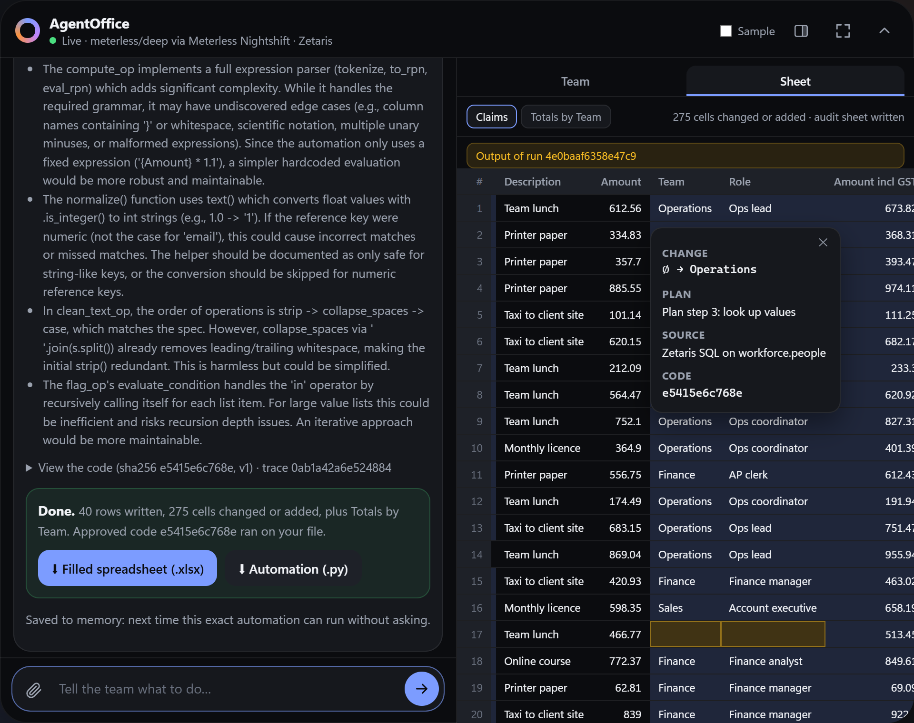
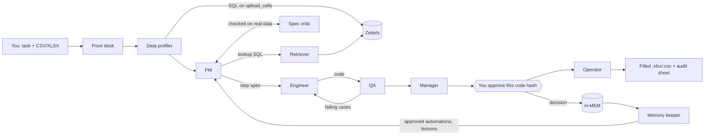
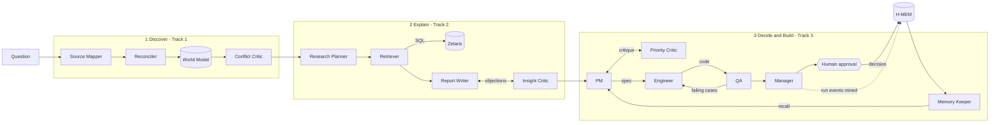

# AgentOffice

**Open Agent Hackathon 2026 · Track 3: Reasoning Architecture · Team Automaters**

**Powered by [Zetaris](#zetaris-the-data-layer) · [Meterless](#meterless-the-model-provider-and-two-engines) · [NVIDIA Nemotron](#nvidia-nemotron-the-reasoning)**

**An AI office team you can just tell what to do.** Attach a spreadsheet and describe the repetitive work. The agents plan it, write the automation, test it on your real data and ask you to approve the exact code before they hand back the filled file. Ask it where your team's time goes, and it finds out, explains why with evidence, and proposes what to automate first.


## For the judges

| Criterion | Where to look |
|---|---|
| **Impact** (30) | [The problem](#the-problem): office teams re-doing the same spreadsheet work every week, including bilingual Arabic/English sheets. [Results](#results): live runs that filled 119 and 275 cells, and found about 24 hours a week of automatable work in the finance data |
| **Technical** (20) | [How it works](#how-it-works): 13 agents in capped critique loops, a QA oracle independent of the code, a sandbox, hash-chained traces, and 227 tests |
| **Innovation** (15) | [What makes it different](#what-makes-it-different): QA that can't flatter the code, approval bound to a code hash, memory that changes behaviour, Arabic-aware matching of IDs, names, dates and amounts |
| **Demo** (15) | [Get started](#get-started): one setup command, then sample mode with no keys. The real outputs and traces of every live run are in [`output_examples/`](output_examples/) |
| **Product & UX** (10) | [The solution](#the-solution): a dynamic island on top of every app on Windows and macOS (Ctrl+Shift+Space), live Team and Sheet panes, requests in English or Arabic, and one approval card |
| **Sponsor tech** (10) | [Built on our sponsors](#built-on-our-sponsors): Zetaris as the data layer for uploads too, Nightshift serving Nemotron to every agent (91 of 91 live model calls), and two Meterless engines built from scratch |

## The problem

Finance, operations and admin teams lose hours every week to the same manual spreadsheet work: looking up who's in which team, fixing dates, tidying categories, flagging the big claims, removing duplicates, totalling it all up. The work is spread across spreadsheets, tickets and email. Nobody has the time to find out which jobs are worth automating, justify it, and build the automation safely.

Generic AI chat doesn't close that gap. It can suggest a formula, but it doesn't test its answer on your file, show you exactly what will change, or ask before it acts. And it breaks quietly on real data. In the UAE and Saudi Arabia, for example, one sheet can hold the same staff ID as `123` and `١٢٣`, or the same name spelled `أحمد` and `احمد`, so a naive lookup simply misses.

**Who it's for:** small and medium office teams with no automation engineer, who need the work done correctly and want to stay in control of what runs on their data.

## The solution

AgentOffice is a desktop app with a team of AI agents behind it. It lives at the top of your screen like a dynamic island; **Ctrl+Shift+Space** opens it from any app.

| You say | What the team does |
|---|---|
| "Fill in each employee's team and role from the staff directory, fix the dates, add GST, flag claims over 500, total by team" + a spreadsheet | Plans the steps, writes a Python automation, tests it on your file, asks you to approve that exact code, then returns the filled workbook |
| The same request next week | Remembers your approval, re-tests the automation on the new file and runs it straight away |
| Look-ups, tidying, mapping, maths, splitting and joining, dates, flags, filters, de-duplication, sorting, group totals | Any combination in one plan, across sheets or against company tables in Zetaris |
| A sheet whose IDs or names mix Arabic and Western digits (`١٢٣` / `123`), spellings (`أحمد` / `احمد`) or scripts (`Mohammed` / `محمد`) | The Data Profiler spots the variants, the PM normalises the lookup keys, the Spec Critic rejects a plan whose keys would still miss, and QA proves the result doesn't change when digits or spellings are swapped. Try the bundled `uae_site_claims.xlsx` and `uae_staff_lookup.xlsx` |
| "املأ الفريق لكل موظف من دليل الأسماء، أصلح التواريخ، وحوّل المبالغ" (fill each person's team, fix the dates, convert the amounts) | The same loop for a request typed in Arabic: dates in Arabic month names or the Hijri calendar become ISO dates, and amounts like `د.إ ١٬٢٥٠٫٥٠` or `SAR 1,100` become numbers. Arabic messages and cells are shown right to left |
| "Where is the finance team losing time, and what should we automate first?" | Finds where the hours go, explains why with cited rows, ranks what to automate, then builds and tests it |
| "Who are the AP clerks in finance?" or "Draft an email to the finance team about last week's hours" | Looks it up with Zetaris SQL, answers or drafts the email from those rows only, and a critic checks every number and person against the data. Drafts are never sent; you copy them. Needs the model (not sample mode) |



| Plan, QA and your approval | Approved and done |
|---|---|
|  |  |

*Screens from a live run of the expense-claims demo: Nemotron through Meterless Nightshift, data through Zetaris.*

### What makes it different

- **A team that argues.** Critics challenge every plan, claim and piece of code, and the work is revised until it passes: Spec Critic → PM, QA → Engineer, Insight Critic → Report Writer, Priority Critic → PM, Grounding Critic → Assistant. Every loop is capped.
- **Tests that can't flatter the code.** QA computes the expected result from the plan with an independent reference runtime, never from the code it's testing. It tests your real rows, mutations of every column (including Arabic digit, spelling and separator swaps), edge cases, and a renamed column that must fail.
- **Approval bound to code.** You approve one exact code hash. Nothing is written before that, the Operator refuses to run code whose hash has changed, and the filled file carries an audit sheet recording who approved which code.
- **Memory that changes behaviour.** An approval lets the same automation run again next week without asking; a rejection changes what the team proposes next.
- **Script-aware matching as part of the reasoning.** Arabic normalisation isn't a bolted-on filter. The profiler surfaces the variants, the plan applies them to lookup and de-duplication keys (Indic digits, letter variants, separators, and Latin spellings of Arabic names such as Mohammed / Muhammad / محمد), the critic can reject a plan because keys only match after normalising, and QA checks the result holds. Dates in Arabic month names or the Hijri calendar, and dirham or riyal amounts, are parsed the same way.
- **Evidence for every number.** Findings cite the SQL rows behind them, and every step lands in a hash-chained trace (`logs/trace-<run_id>.jsonl`).
- **Watch the team work.** Beside the chat, the **Team** pane draws each agent, handoff and critique as it happens, and the **Sheet** pane shows every cell the approved code changed, with its old value and the plan step behind it. Any past run on your machine can be replayed from its trace; hide the pane for a narrow chat.
- **Runs without keys.** Sample mode runs the real agent logic on bundled synthetic data, with no keys and no network.

## Built on our sponsors

| Sponsor | Its role in AgentOffice | Where in the code | Proof |
|---|---|---|---|
| **Zetaris** | The data layer: company tables *and your uploaded spreadsheets* are queried through Zetaris SQL | [`app/adapters/zetaris.py`](app/adapters/zetaris.py), [`app/data.py`](app/data.py), [`scripts/load_zetaris.py`](scripts/load_zetaris.py) | 7 REST tables registered and verified on Zetaris 2.4.3; `data_query` events in every live trace |
| **Meterless Nightshift** | The primary model provider for every agent (Power rule) | [`app/adapters/meterless.py`](app/adapters/meterless.py), [`app/llm.py`](app/llm.py) | `scripts/check_connections.py`, `GET /providers/meterless`; the `model` field of every model call in the traces |
| **Meterless World Model** | The shared state all agents read and write (Build rule) | [`app/engines/world_model/`](app/engines/world_model/) | 18 tests; `world_model_write` events in every live run |
| **Meterless H-MEM** | Memory across runs: human decisions and QA lessons | [`app/engines/hmem/`](app/engines/hmem/) | 16 tests, including learned → retrieved → behaved differently |
| **NVIDIA Nemotron** | The reasoning behind every model call: planning, SQL, code, tests, critique, decisions | served through Nightshift (`meterless/deep`) | Nemotron answers every model call in `output_examples/*.trace.jsonl`: `nemotron-3-ultra-550b-a55b`, and `nemotron-3.5-lightning-30b-a3b` for a few analysis calls |

### Zetaris: the data layer

In AgentOffice, Zetaris isn't just a database the agents read from. **Your spreadsheet becomes a Zetaris table the moment you upload it.**

- The service exposes every upload as long-format cells, and Zetaris registers them as the **Lightning REST table** `upload_cells`. The Data Profiler profiles your file with Zetaris SQL before the PM plans anything.
- Lookups join your file with company data in Zetaris. For example, the expense-claims demo fills each claim's team and role from the staff directory in `workforce.people`; the Retriever runs that SQL and the Spec Critic checks that its keys actually match your file.
- Analysis mode grounds every finding in Zetaris SQL across five workforce tables: timesheets, tickets, email events, the activity log and people.
- The agents write portable SQL against `workforce.<table>`. The data adapter rewrites each reference to read the REST table at query time, so no views or extra objects are needed, and the trace records the SQL that actually ran. Values written in Arabic digits or script come back as text, so they're never mangled into numbers on the way.

Verified on a local Zetaris 2.4.3 install: all 7 statements succeed, every row count matches the generator's manifest, uploads are queryable immediately, and the analysis pipeline's 15 queries give findings identical to sample mode.

### Meterless: the model provider and two engines

**Nightshift is the primary model provider.** Every agent that reasons with a model, from the front desk to the Manager, calls it through one injected generator. The Spec and Priority Critics are deterministic rules on purpose, and the Insight and Grounding Critics check by rule first, then add a model review. The adapter implements the published provider contract:

- URL normalisation, and status from `GET /v1/models` (online, unauthorized or offline)
- auto-detect across ports 8088, 8090, 8787 and 11434
- connect links (`/connect#k=`), the `meterless-app` and `meterless-scope` headers, and a 180-second timeout
- Test Connection, as `GET /providers/meterless` and `scripts/check_connections.py`

**We built two Meterless engines from scratch, and both drive the product.**

- **World Model**, the shared spine. It has content-hash stable IDs, an append-only observation log that requires provenance, a 10-step idempotent and resumable ingest, canonical reconstruction, and a budgeted context builder. Every analysis stage reads its context from it and writes back. When timesheets, tickets and the activity log disagree, the World Model records the conflict with evidence, and the Conflict Critic judges exactly those records.
- **H-MEM**, the team's long-term memory. It has the reference record fields, types and layers, a programmable approval boundary, conflict resolution that supersedes and never deletes, the 8-signal retrieval formula with a `retrievalReason`, and a hash-chained trust ledger. Your approval becomes a long-term memory, so the same automation runs again without asking. A rejection means the next run proposes a different routine, and QA lessons from earlier runs feed the Engineer's prompt.

### NVIDIA Nemotron: the reasoning

Every model call in the live runs was answered by NVIDIA Nemotron through the Nightshift route `meterless/deep`: **`nvidia/nemotron-3-ultra-550b-a55b`** for all the spreadsheet tasks and most analysis calls, and `nvidia/nemotron-3.5-lightning-30b-a3b` for the 2 or 3 analysis calls per run that Nightshift routed there. Each trace records which model answered. It's hosted, so no local GPU is needed. Nemotron routes requests, writes the step specs and SQL, writes and revises the code, designs extra test cases, reviews the code, critiques the claims, writes the decision memos, and answers questions and drafts emails from Zetaris rows.

**By the numbers:** in the seven saved live runs, **91 of 91 model calls were answered by Nemotron** (77 by Nemotron 3 Ultra, 14 by Nemotron 3.5 Lightning; 700,341 tokens), across **13 agents**, from QA (14 calls) to the Reconciler and Conflict Critic (3 each). Reproduce it with `python scripts/nemotron_usage.py`.

In the live expense-claims run, Nemotron wrote a 7-step plan with lookup SQL on the staff directory. QA rejected its first two versions of the code: v1 broke the sandbox policy, and v2 mishandled blank and text-typed amounts. Version 3 passed **49/49** cases. AgentOffice handles Nemotron as a reasoning model: it strips the reasoning from each reply, gives the model an 8,000-token budget, and detects and retries replies cut off at the length limit. Prompts carry Arabic text as real script, not escape codes, so Nemotron reads the values as written.

**Speed:** each call goes to a Nightshift lane. Light jobs (routing, the first plan, QA's test design and review, the Manager's memo, memory) go to Nemotron 3.5 Lightning with thinking off. Code, and anything a critic rejects, goes to Nemotron 3 Ultra. QA designs its tests while Ultra writes the code. A live expense-claims task now reaches your approval in about **4 to 6 minutes** instead of 5 to 10 (details in [ARCHITECTURE.md](docs/ARCHITECTURE.md#nvidia)).

The full sponsor write-up, with the tests and traces behind each claim, is in [docs/SPONSOR_TECH.md](docs/SPONSOR_TECH.md).

## How it works

**Task mode** turns a sentence and a spreadsheet into a tested, approved automation:



**Analysis mode** answers "where is our time going?" with 13 agents in three stages, all sharing one World Model:



**Questions and email drafts** use a shorter loop: the Assistant plans what to look up, the Retriever runs read-only SQL on Zetaris, the Assistant writes from those rows only (people reach the model as placeholders), and the Grounding Critic sends back any number or person the data doesn't support, then has the model check that each figure is tied to the right week, person or category. Nothing is sent; you copy the draft.

### Why this is Track 3: reasoning, not a linear pipeline

| Pattern the track asks for | Where it lives in AgentOffice |
|---|---|
| Planner ↔ critic ↔ revise, capped | PM ↔ Spec Critic on the real file and the Zetaris reference data (2 rounds); Priority Critic on savings claims (2 rounds); Insight Critic on cited numbers (2 rounds) |
| Executor ↔ evaluator iterate | Engineer ↔ QA (3 revisions). In the live expense-claims run QA rejected v1 and v2 before v3 passed 49/49 ([trace](output_examples/task_expense_claims.trace.jsonl)) |
| Shared state | The World Model in analysis mode; the upload as the Zetaris table `upload_cells` in task mode |
| Memory that changes later behaviour | H-MEM: an approval means reuse without asking; a rejection means a different proposal next run |
| Escalation to a human | The Manager's memo and the code-hash gate; the Manager escalates instead of re-submitting code a human rejected |
| Recovery from wrong output | Spec Critic rejections force a re-plan; QA's failing cases drive the Engineer's revision; Retriever SQL errors go back to the model (3 attempts); sandbox policy violations fail loudly |

| Track | Where AgentOffice covers it | Agents | Engine |
|---|---|---|---|
| **3 Reasoning Architecture (primary)** | Decide and build: rank, specify, build, test, decide, ask a human, remember | PM, Priority Critic, Engineer, QA, Manager, Memory Keeper | H-MEM + World Model |
| 1 Fragmented Intelligence | Discover: reconcile timesheets, tickets and the activity log, and judge which source to trust | Source Mapper, Reconciler, Conflict Critic | World Model |
| 2 Explain Why | Explain: answer with SQL evidence, and drop any claim a critic can't verify | Research Planner, Retriever, Report Writer, Insight Critic | World Model |

**Built to be reliable:** every external call has a timeout, bounded retries and a structured error; every agent loop has an iteration cap, with at most 40 model calls per analysis run. Generated code runs in a sandbox (a static import and call policy, an isolated subprocess with an empty environment, and a timeout), and 227 tests cover the agents, both engines, the adapters and the sandbox.

Each agent's role, the QA design and the engine internals are in [docs/ARCHITECTURE.md](docs/ARCHITECTURE.md).

## Results

Everything in [`output_examples/`](output_examples/) is a **real response with its trace**, saved by `scripts/run_examples.py`; the app never reads these files. The live runs (Zetaris + Nemotron via Nightshift, 25 Oct 2026, plus the UAE demo run recorded on 27 Oct) are at the top level, and the sample-mode runs are in [`output_examples/sample_mode/`](output_examples/sample_mode/).

**Spreadsheet tasks** use the demo files in [`data/sample/tasks/`](data/sample/tasks/):

| Demo file | Live run (Nemotron wrote the spec and code) | Sample mode |
|---|---|---|
| `leads_and_contacts.xlsx`: split names, match leads to the CRM sheet, fill owner | 4-step plan; the code passed **34/34** QA cases on the first try (6 designed by the model); 119 cells filled after approval | 18/18 cases |
| `expense_claims.xlsx`: team and role from the staff directory in Zetaris, tidy categories, ISO dates, GST, flag > 500, totals by team | 7-step plan with lookup SQL on `workforce.people`, and **three QA rounds** (v3 passed **49/49**); 275 cells filled and a *Totals by Team* sheet after approval | 36/36 cases |
| `uae_site_claims.xlsx`: team and role by staff ID typed in Western, Arabic-Indic or Persian digits, flag > 1,000 AED, totals by team | Live on 27 Oct, recorded for the demo video ([trace](output_examples/task_uae_site_claims.trace.jsonl)): the request never mentions Arabic, yet the PM put `arabic_digits` on the lookup key after the profiler's note; **17 of 18** IDs matched (the one not on staff is flagged); QA rejected v1 (43/47) and v2 passed **47/47**; 88 cells filled after approval | 17 of 18 matched; 24/24 cases |
| `uae_staff_lookup.xlsx`: claims matched to an Arabic-script directory sheet by staff ID and by Latin name (`Mohammed Ali` / `محمد علي`), Arabic and Hijri dates, dirham and riyal amounts | Live on 27 Oct, 2 runs: one passed after QA sent v1 back (31 cells filled after approval); in the other, Nemotron's code stopped at **41 of 42** QA cases after four revisions, so the Manager rejected it and nothing was written. Converting Hijri dates exactly is the hard part for the model. Measured on the file with `python scripts/measure_arabic_lookup.py`: an exact-match name lookup finds **0 of 8**, and with `arabic_names` **8 of 8**; staff IDs go from 4 of 8 to **8 of 8** with `arabic_digits` | 8 of 8 matched by ID and name; 40/40 cases |
| `vendor_invoices.csv`: dedupe, fill statuses, mark overdue, sort | 6-step plan; the code passed **40/40** QA cases on the first try (6 designed by the model); 34 rows in, 30 out after removing the re-typed duplicates | 24/24 cases |

**Analysis questions** are in [`input_examples/`](input_examples/). Different questions give different answers, measured on the synthetic workforce data. The hours below show how the Priority Critic caps a claim at the hands-on time the activity log measures; they are not a claim about any real company's savings:

| Question | Live run (Nemotron) | Sample mode |
|---|---|---|
| Finance: where are we losing time? | `invoice_matching` first, about 24.4 h/week (high risk); the code passed 28/28 QA cases | `invoice_po_matcher`, about 23 h/week; 22/22 |
| Operations: what repetitive work is eating the week? | `order_status_updates`, about 7.9 h/week (medium risk); 25/25 | `order_status_responder`, about 6.2 h/week; 19/19 |
| Sales: is CRM data entry worth automating? | `crm_data_entry`, about 7.1 h/week (medium risk); 28/28 | `lead_contact_deduper`, about 5.4 h/week; 22/22 |

## Get started

On Windows, with Python 3.11 or newer:

```powershell
git clone https://github.com/allurimohansrisaivarma-coder/AgentOffice.git
cd AgentOffice
powershell -ExecutionPolicy Bypass -File setup.ps1
```

Open **AgentOffice** from the Start menu and press **Ctrl+Shift+Space**: the island opens over whatever app you're in. On **macOS**, install Chrome or Edge and double-click `AgentOffice.command` (or `AgentOffice.app`); macOS may ask once for Accessibility access to place the window, and without it you get a normal app window. With no keys it runs in **sample mode**: pick a demo file, send its suggested request, and watch the team work. Your own CSV or Excel files work too: a rule-based planner maps requests like *"remove duplicate order IDs, standardise order dates, add 10% GST to Amount, flag amounts over 1,000, totals by Region"* onto your columns, and QA tests the result on your file ([what it understands](docs/SETUP.md#3-try-it-in-sample-mode)).

For testing, the same agent service also runs without the desktop shell:

- **In a browser (any OS):** `.\.venv\Scripts\python.exe run.py`, then open http://localhost:8000.
- **In Docker, with no keys:** `docker build -t oah-submission .`, then `docker run --rm -p 8000:8000 -e SAMPLE_MODE=true oah-submission`.
- **From a script, with no UI:** `curl -X POST http://localhost:8000/run -H "Content-Type: application/json" -d @input_examples/example_1.json`. In Windows PowerShell, type `curl.exe`; every endpoint is in [docs/API.md](docs/API.md).

To connect Zetaris and Meterless Nightshift for live runs on your own files, follow the [setup guide](docs/SETUP.md).

## Submission

- **Event:** Open Agent Hackathon 2026. **Team:** Automaters.
- **Primary track:** Track 3, Reasoning Architecture; Tracks 1 and 2 are covered as stages of the same pipeline.
- **Materials:** the slide deck ([PDF](docs/AgentOffice-deck.pdf), [slide source](docs/deck/)), the [sponsor technology explanation](docs/SPONSOR_TECH.md) and [`metadata.json`](metadata.json).

## Built with

- **Models:** Meterless Nightshift (primary; NVIDIA Nemotron lanes). Any OpenAI-compatible endpoint can be used as a secondary provider (`LLM_PROVIDER=openai_compatible`).
- **Agent framework:** none. The agents are plain Python written for this project.
- **Libraries:** FastAPI (MIT), Uvicorn (BSD-3-Clause), httpx (BSD-3-Clause), python-dotenv (BSD-3-Clause), openpyxl (MIT), and pytest (MIT, development only).
- **UI:** plain HTML, CSS and JavaScript written for this project, with no framework or CDN. The desktop island (Windows and macOS) drives Microsoft Edge or Google Chrome in app mode, through Python's standard `ctypes` on Windows and AppleScript on macOS.
- **Data:** synthetic only, generated by committed, deterministic scripts; invented people, with `example.com` and `example.org` emails. See [data/README.md](data/README.md).
- **Open-source code adapted:** none. Design ideas, not code, are listed in [docs/INSPIRATION.md](docs/INSPIRATION.md). The World Model and H-MEM follow the Meterless reference *designs*, reimplemented.
- **Pre-existing components:** none. All code was written in this repository from 23 Oct 2026.
- **AI coding tools:** developed with **Claude Code** (Anthropic); the split-view Team and Sheet panes, the macOS desktop island and the extended Arabic support were built with **Cursor**. The team reviewed and tested all AI-generated code; the suite has 227 tests.
- **Sample mode and design boundaries:** documented in [docs/ARCHITECTURE.md](docs/ARCHITECTURE.md#design-boundaries).

## Documentation

| Document | What's in it |
|---|---|
| [docs/SETUP.md](docs/SETUP.md) | Installing, starting, live mode with Zetaris and Nightshift, configuration, troubleshooting |
| [docs/API.md](docs/API.md) | Every endpoint, plus a scripted spreadsheet task from upload to download |
| [docs/ARCHITECTURE.md](docs/ARCHITECTURE.md) | Agents and their roles, the QA design, engine internals, sample mode, the repository map |
| [docs/SPONSOR_TECH.md](docs/SPONSOR_TECH.md) | How Zetaris, Meterless and NVIDIA are used, and the tests that prove it |
| [data/README.md](data/README.md) | The synthetic data: what it holds, how it's generated, how it reaches Zetaris |
| [docs/INSPIRATION.md](docs/INSPIRATION.md) | The design patterns we reimplemented from scratch (ideas only, no code) |
