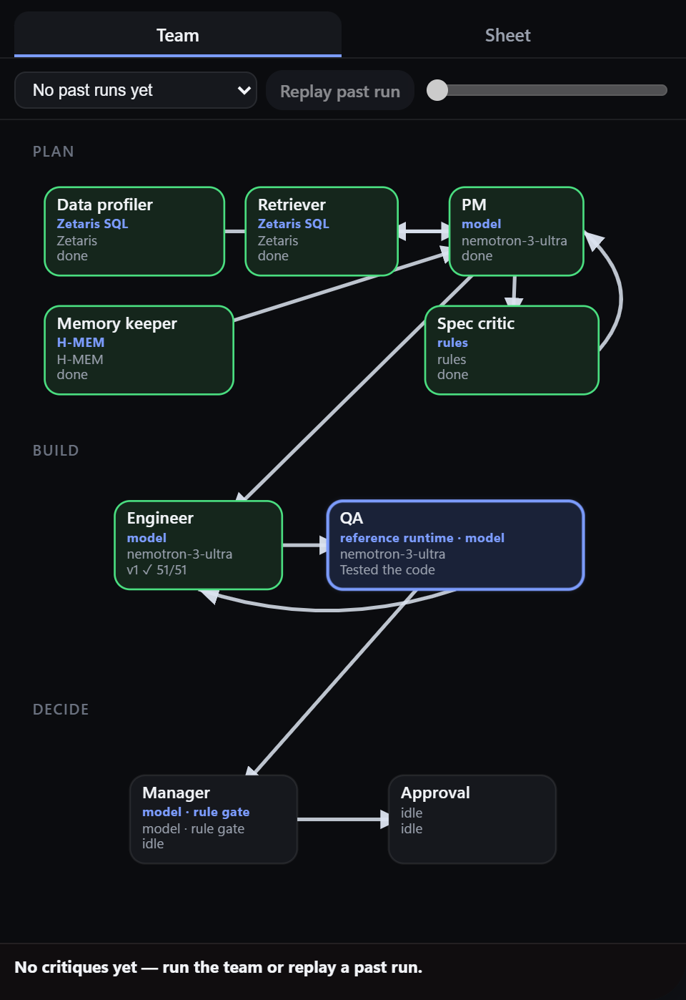
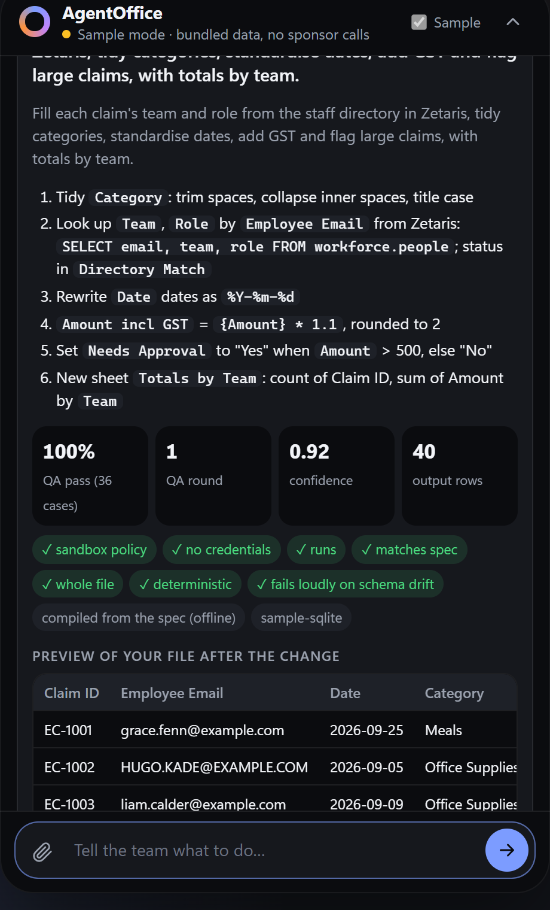
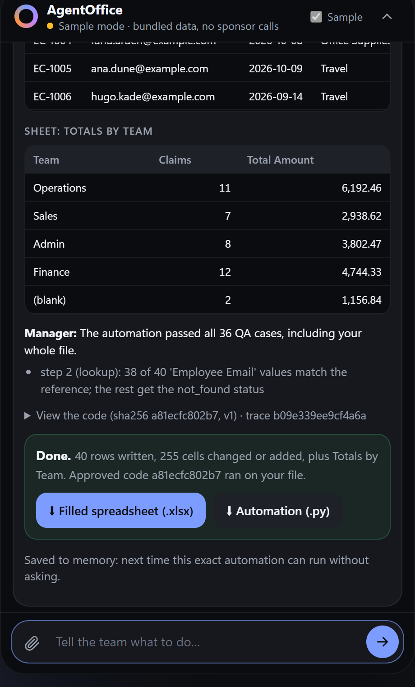
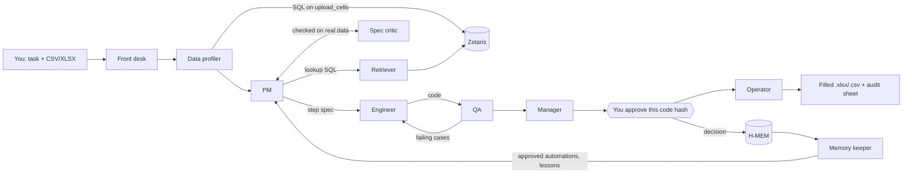
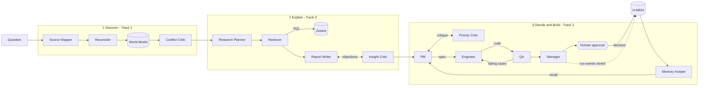

# AgentOffice

**Open Agent Hackathon 2026 · Track 3: Reasoning Architecture · Team Automaters**

**Powered by [Zetaris](#zetaris-the-data-layer) · [Meterless](#meterless-the-model-provider-and-two-engines) · [NVIDIA Nemotron](#nvidia-nemotron-the-reasoning)**

**An AI office team you can just tell what to do.** Attach a spreadsheet and describe the repetitive work. The agents plan it, write the automation, **test it against an independent oracle on your real rows**, and ask you to approve **one exact code hash** before they hand back the filled file. Ask where time is going on the workforce data in Zetaris, and they explain with cited SQL — then build and test the automation.


## The problem (real users, not a slide claim)

Finance, ops and admin teams in the **UAE and Saudi Arabia** still live in spreadsheets for claims, invoices, leads and directory lookups — while both countries push hard on digital transformation. That is a concrete user need, not a synthetic story:

- **Spreadsheets still dominate prep work.** Alteryx’s 2025 analyst research found **76% of analysts still rely on spreadsheets** for data preparation, and nearly half spend **over six hours a week** cleaning data; in the Middle East, **93% (UAE) and 91% (Saudi Arabia)** said AI had already changed their work in the past year ([Times of Startups / Alteryx](https://timesofstartups.com/research/new-alteryx-research-reveals-that-ai-brings-productivity-gains-but-reliance-on-spreadsheets-puts-data-quality-at-risk/)).
- **Gulf teams want automation, but skills and tooling lag.** YouGov research for Alteryx across UAE and Saudi organisations found about **half of Gulf data workers** already automate day-to-day tasks (vs 16% UK / 24% Germany), yet upskilling remains uneven ([The National](https://www.thenationalnews.com/business/technology/2022/01/13/half-of-gulf-data-workers-now-rely-on-automation-to-perform-their-tasks/)).
- **Regional back offices are already proving the value of automating repetitive finance work** — with *published* outcomes, not ours: Saudi ZATCA’s RPA “Ziyad” cut a repeated data task from **14 minutes to 13 seconds** ([ZATCA](https://zatca.gov.sa/en/MediaCenter/News/Pages/Ziyad-at-GITEX-Global-2023.aspx)); Riyad Capital cut CMA-request checking from ~**1,024 to ~73 hours/month** ([UiPath case study](https://www.uipath.com/resources/automation-case-studies/riyad-capital-uses-rpa-to-save-time)).
- **UAE/Saudi sheets mix scripts in ways that break naive lookups.** The UAE uses **both Eastern (٠١٢٣) and Western (0123) Arabic numerals** ([Wikipedia: Eastern Arabic numerals](https://en.wikipedia.org/wiki/Eastern_Arabic_numerals)); CLDR for `ar_AE` defines Arabic decimal **٫** and thousands **٬** ([Unicode CLDR ar_AE](https://unicode.org/cldr/cldr-aux/charts/24/summary/ar_AE.html)). Real staff directories and claim IDs therefore fail to match when أ/إ/آ, ة/ه, ي/ى, tatweel or Indic digits differ — exactly the failure mode AgentOffice’s Data Profiler, Spec Critic and lookup keys are built for.

**What we claim vs what we demonstrate.** The *problem* above is grounded in published reporting. The *demo corpus* (synthetic workforce tables and sample CSVs) is instrumentation so judges can run the full agent loop without customer data. Hours such as “24.4 h/week” in analysis traces are **measured on that synthetic activity log**, not a customer SLA — see [Evidence discipline](#evidence-discipline).

## The solution

AgentOffice is a small office of specialised agents. On Windows it can sit as a **dynamic island** (**Ctrl+Shift+Space**); on any OS judges use the **browser UI** or **Docker** (same agents, same traces).

| You say | What the team does |
|---|---|
| "Fill each employee's team and role from the staff directory, fix the dates, add GST, flag claims over 500, total by team" + a spreadsheet | Plans steps, writes Python, QA-tests it on your file (oracle + mutations + Arabic digit/name swaps), asks you to approve that **code hash**, returns the filled workbook + audit sheet |
| The same request next week | H-MEM recalls the approval; QA re-tests on the new file; Operator runs without asking again |
| UAE/Saudi IDs and names with `٠١٢٣`, `أ/إ/آ`, `ة/ه`, `٫`/`٬` | Data Profiler flags script variants; PM puts `arabic_digits` / `arabic_text` / `arabic_separators` on lookup keys; Spec Critic rejects plans whose keys only match after those steps |
| "Where is the finance team losing time, and what should we automate first?" | Grounds the answer in Zetaris SQL, ranks candidates under a Priority Critic, then builds and tests the automation |

| The team at work | Plan, QA and preview | Approved and done |
|---|---|---|
|  |  |  |

### Why this is Track 3 (Reasoning Architecture) — not a linear pipeline

Judges look for critique, shared state, retries and escalation. AgentOffice is built around those loops:

| Pattern the brief asks for | Where it lives |
|---|---|
| Planner ↔ critic ↔ revise (capped) | PM ↔ Spec Critic on the real file + Zetaris reference; Priority Critic on savings claims; Insight Critic on cited numbers |
| Executor ↔ evaluator iterate | Engineer ↔ QA; QA rejected **v1 and v2** of the live expense-claims code before **v3** passed 49/49 ([trace](output_examples/task_expense_claims.trace.jsonl)) |
| Shared state | World Model for analysis; uploaded sheet + Zetaris `upload_cells` for tasks |
| Memory that changes later behaviour | H-MEM: approval → reuse without re-asking; rejection → different proposal next run |
| Escalation to a human | Manager memo + **code-hash gate**; Operator refuses to write if the hash drifts |
| Recovery from incomplete / wrong output | Spec Critic forces PM replan; QA failure purposes feed Engineer revise; sandbox policy violations fail loudly |

### What makes it different (innovation beyond “we have critics”)

A multi-agent critic loop alone is no longer novel. The distinctive pieces are:

- **QA that cannot flatter the code.** Expected output comes from `app/tasks/runtime.py` (the oracle), never from the Engineer’s module. Cases include real rows, per-column mutations, Arabic digit/name/separator swaps, step edge cases, and a renamed column that must raise.
- **Approval bound to one code hash.** Nothing is written before a human approves that hash; the output workbook carries an audit sheet naming who approved which code.
- **Memory that changes behaviour.** Approvals and rejections are H-MEM records, not chat fluff — the next run retrieves them and acts differently (`tests/test_hmem.py`).
- **Script-aware keys as part of the reasoning story.** Arabic normalisation is not a bolted-on filter: the Data Profiler surfaces it, lookup/dedupe keys apply it, Spec Critic can reject “keys don’t match because of Arabic script variants,” and QA mutates digits/spellings to prove the result is unchanged.

## Built on our sponsors

| Sponsor | Its role in AgentOffice | Where in the code | Proof |
|---|---|---|---|
| **Zetaris** | The data layer: company tables *and your uploaded spreadsheets* are queried through Zetaris SQL | [`app/adapters/zetaris.py`](app/adapters/zetaris.py), [`app/data.py`](app/data.py), [`scripts/load_zetaris.py`](scripts/load_zetaris.py) | 7 REST tables on Zetaris 2.4.3; `data_query` events in every live trace; Arabic cell values survive REST coerce |
| **Meterless Nightshift** | Primary model provider for every agent (Power rule) | [`app/adapters/meterless.py`](app/adapters/meterless.py), [`app/llm.py`](app/llm.py) | `scripts/check_connections.py`, `GET /providers/meterless`; `model` on every call in the traces |
| **Meterless World Model** | Shared state agents read and write (Build rule) | [`app/engines/world_model/`](app/engines/world_model/) | 18 tests; `world_model_write` in every live run |
| **Meterless H-MEM** | Cross-run memory: approvals and QA lessons | [`app/engines/hmem/`](app/engines/hmem/) | 16 tests, including learned → retrieved → behaved differently |
| **NVIDIA Nemotron** | Reasoning for planning, SQL, code, tests, critique, decisions | Nightshift route `meterless/deep` | `nvidia/nemotron-3-ultra-550b-a55b` on model calls in `output_examples/*.trace.jsonl` |

### Zetaris: the data layer

In AgentOffice, Zetaris isn’t a bolted-on database. **Your spreadsheet becomes a Zetaris table the moment you upload it.**

- Uploads are served as long-format cells; Zetaris registers them as Lightning REST table `upload_cells`. The **Data Profiler** profiles the file with Zetaris SQL before the PM plans.
- Lookups join your file with company data in Zetaris (e.g. expense claims → `workforce.people`). The Retriever runs that SQL; the Spec Critic checks keys actually match — including after `arabic_*` normalisation when Indic digits or name variants are present.
- Analysis mode grounds every finding in Zetaris SQL across timesheets, tickets, email events, the activity log and people.
- Agents write portable `workforce.<table>` SQL; the adapter rewrites each reference to the REST table at query time. Arabic-Indic digit strings and Arabic names stay strings through coerce (they are not mangled into ASCII numbers).

### Meterless: the model provider and two engines

**Nightshift is the primary model provider for every agent.** One injected generator serves Front Desk through Manager. The adapter follows the published contract (URL normalisation, `GET /v1/models` status, auto-detect, connect links, `meterless-app` / `meterless-scope`, 180s timeout).

**Two Meterless engines, both in working features:**

- **World Model** — content-hash IDs, provenance-required observation log, resumable ingest, budgeted context. Analysis stages read/write it; Conflict Critic judges its conflict records.
- **H-MEM** — approval boundary, supersede-not-delete conflicts, 8-signal retrieval. Your approval becomes long-term memory so the same automation runs again; a rejection changes the next proposal; QA lessons feed the Engineer.

### NVIDIA Nemotron: the reasoning

Every agent thinks with **`nvidia/nemotron-3-ultra-550b-a55b`** via `meterless/deep` (hosted; no local GPU). In the live expense-claims run, Nemotron wrote a 7-step plan with lookup SQL on the staff directory. **QA rejected v1 (sandbox policy) and v2 (blank / text-typed amounts); v3 passed 49/49.** AgentOffice strips Nemotron reasoning tags, budgets 8,000 tokens, and retries length cut-offs.

Full sponsor write-up: [docs/SPONSOR_TECH.md](docs/SPONSOR_TECH.md).

## How it works

**Task mode** — sentence + spreadsheet → tested, approved automation:



**Analysis mode** — “where is time going?” with 13 agents and one World Model:



| Track | Where AgentOffice covers it | Agents | Engine |
|---|---|---|---|
| **3 Reasoning Architecture (primary)** | Decide and build: rank, specify, build, test, decide, ask a human, remember | PM, Priority Critic, Engineer, QA, Manager, Memory Keeper | H-MEM + World Model |
| 1 Fragmented Intelligence | Discover: reconcile timesheets, tickets and activity log | Source Mapper, Reconciler, Conflict Critic | World Model |
| 2 Explain Why | Explain: SQL-backed answers; drop unverifiable claims | Research Planner, Retriever, Report Writer, Insight Critic | World Model |

Roles and QA design: [docs/ARCHITECTURE.md](docs/ARCHITECTURE.md).

## Results

Everything in [`output_examples/`](output_examples/) is a **real response with its hash-chained trace**, saved by `scripts/run_examples.py` (the app never reads these files). Live runs (Zetaris + Nemotron via Nightshift, 25 Oct 2026) sit at the top level; sample-mode mirrors are in [`output_examples/sample_mode/`](output_examples/sample_mode/).

### Spreadsheet tasks (usable output for a real person)

Demo files in [`data/sample/tasks/`](data/sample/tasks/):

| Demo file | Live run (Nemotron wrote the spec and code) | Sample mode |
|---|---|---|
| `leads_and_contacts.xlsx` — split names, match CRM, fill owner | 4-step plan; **34/34** QA on first try; 119 cells filled after approval | 18/18 |
| `expense_claims.xlsx` — staff directory in Zetaris, dates, GST, flags, team totals | 7-step plan; **QA rejected v1 and v2; v3 passed 49/49**; 275 cells + *Totals by Team* | 36/36 |
| `vendor_invoices.csv` — dedupe, statuses, overdue, sort | 6-step plan; **40/40** QA; 34 → 30 rows after removing re-typed duplicates | 24/24 |

### Analysis questions (synthetic corpus — labelled as such)

Questions in [`input_examples/`](input_examples/). Rankings and “h/week” figures are **hands-on time measured on the bundled synthetic activity log** (so the Priority Critic and QA have deterministic evidence). They illustrate the decide-and-build loop; they are **not** a claim about a named customer’s payroll.

| Question | Live ranking on the synthetic log | Sample mode |
|---|---|---|
| Finance: where are we losing time? | `invoice_matching` first (~24.4 measured h/week on the demo log); code 28/28 | ~23 h/week demo; 22/22 |
| Operations: repetitive work? | `order_status_updates` (~7.9 measured h/week); 25/25 | ~6.2; 19/19 |
| Sales: CRM data entry? | `crm_data_entry` (~7.1 measured h/week); 28/28 | ~5.4; 22/22 |

### Evidence discipline

| Kind of claim | Source |
|---|---|
| UAE/Saudi spreadsheet & automation need | Cited press and case studies in [The problem](#the-problem-real-users-not-a-slide-claim) |
| “This automation works on this file” | Live QA pass rates + filled workbooks in `output_examples/` |
| “Agents recovered from failure” | Expense-claims trace: v1/v2 rejected, v3 passed |
| “Nemotron answered every call” | `model` field on each model-call event in the traces |
| Hours on the demo corpus | Synthetic generator + Zetaris tables — labelled above, not sold as customer ROI |

## Get started (any OS)

Judges on macOS/Linux: use **browser** or **Docker**. The Windows desktop island is optional chrome around the same service.

```bash
git clone https://github.com/allurimohansrisaivarma-coder/AgentOffice.git
cd AgentOffice
python3 -m venv .venv
source .venv/bin/activate          # Windows: .\.venv\Scripts\Activate.ps1
pip install -r requirements.txt
cp .env.example .env               # leave placeholders → sample mode
python run.py                      # http://localhost:8000
```

Or: `docker build -t oah-submission . && docker run --rm -p 8000:8000 -e SAMPLE_MODE=true oah-submission`.

With no keys, **sample mode** runs the real agents on bundled data. Pick a demo file, send its suggested request, watch Spec Critic / QA / approval.

- **Windows island (optional):** `powershell -ExecutionPolicy Bypass -File setup.ps1`, then **Ctrl+Shift+Space**.
- **Live Zetaris + Nightshift:** [docs/SETUP.md](docs/SETUP.md).
- **API:** `curl -X POST http://localhost:8000/run -H "Content-Type: application/json" -d @input_examples/example_1.json` — [docs/API.md](docs/API.md).

### Demo video checklist (1–4 min)

To protect the Demo score, the recording should show a **full loop**, not only a happy path:

1. Attach a spreadsheet and state the task  
2. Data Profiler / PM plan (and Spec Critic if it forces a revise)  
3. **QA rejecting a version**, then Engineer revise, then a passing round  
4. Human approval of the **code hash**  
5. Download the filled file / audit sheet  
6. Call out Zetaris (`upload_cells` or lookup SQL) and Nightshift/Nemotron in the trace  

Expense claims is the clearest recorded example of (3): [`output_examples/task_expense_claims.trace.jsonl`](output_examples/task_expense_claims.trace.jsonl).

## Submission

- **Event:** Open Agent Hackathon 2026. **Team:** Automaters.
- **Primary track:** Track 3, Reasoning Architecture; Tracks 1 and 2 appear as stages of the same pipeline.
- **Materials:** slide deck ([PDF](docs/AgentOffice-deck.pdf), [source](docs/deck/)), [sponsor technology explanation](docs/SPONSOR_TECH.md), [`metadata.json`](metadata.json).

## Built with

- **Models:** Meterless Nightshift (primary; NVIDIA Nemotron lanes). Optional secondary: `LLM_PROVIDER=openai_compatible`.
- **Agent framework:** none — plain Python for this project.
- **Libraries:** FastAPI, Uvicorn, httpx, python-dotenv, openpyxl, pytest (dev).
- **UI:** plain HTML/CSS/JS, no framework CDN. Desktop island (Windows) drives Edge/Chrome via `ctypes`.
- **Data:** synthetic demo corpus from committed generators (`example.com` emails) — [data/README.md](data/README.md). Used so the system is reproducible without customer PII.
- **Open-source code adapted:** none. Design ideas only: [docs/INSPIRATION.md](docs/INSPIRATION.md). World Model and H-MEM follow Meterless *designs*, reimplemented.
- **Pre-existing components:** none. Written in this repository from 23 Oct 2026.
- **AI coding tool:** Claude Code (Anthropic); team reviewed generated code. **~190 tests** in `tests/`.
- **Secrets:** environment variables / private `.env` only; [`.env.example`](.env.example) has placeholders. NVIDIA keys belong in Nightshift’s Providers tab, not this repo.

## Documentation

| Document | What's in it |
|---|---|
| [docs/SETUP.md](docs/SETUP.md) | Install, sample vs live mode, Zetaris + Nightshift, troubleshooting |
| [docs/API.md](docs/API.md) | Endpoints; scripted task from upload to download |
| [docs/ARCHITECTURE.md](docs/ARCHITECTURE.md) | Agents, QA design, engines, sample mode, repo map |
| [docs/SPONSOR_TECH.md](docs/SPONSOR_TECH.md) | Zetaris, Meterless, NVIDIA — with the tests that prove each |
| [data/README.md](data/README.md) | Synthetic data: contents, generation, path into Zetaris |
| [docs/INSPIRATION.md](docs/INSPIRATION.md) | Design patterns reimplemented (ideas only) |
