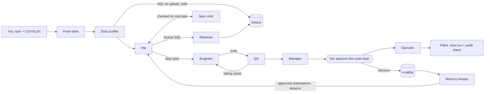
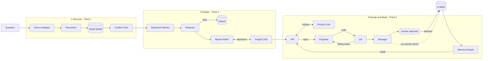

# AgentOffice

**An AI office team you can just tell what to do. Attach a spreadsheet, describe the repetitive work ("fill in each person's team from the staff directory, fix the dates, flag the big claims, total by team"), and the agents plan it, write the automation, test it on your real data and ask you to approve the exact code before they hand back the filled file. Ask it where your team's time goes, and it finds out, explains why with evidence, and proposes what to automate first.**

This is our Open Agent Hackathon 2026 submission. The primary track is **Track 3, Reasoning Architecture**. The analysis pipeline also addresses Track 1 (Fragmented Intelligence) and Track 2 (Explain Why).

> **Status (25 Oct 2026):** task mode, the analysis pipeline, the chat UI and the Windows desktop island all run end to end in **sample mode** and in **default mode** (Zetaris + Meterless Nightshift serving NVIDIA Nemotron). Live traces, outputs and filled workbooks are in [`output_examples/`](output_examples/). See [Done vs not yet](#done-vs-not-yet).

## Use it

- **Chat UI:** start the API (`python run.py`) and open http://localhost:8000. A dark "dynamic island" pill sits at the top; click it or press **Ctrl+Shift+Space** (or **Ctrl+K**) and it opens into a chat panel. Drop a CSV/Excel file on it or pick a demo file, type what you want, and watch the team work live.
- **Desktop island (Windows):** `python scripts/island.py` puts the same island on top of every app, like Copilot: **Ctrl+Shift+Space** from anywhere opens it, Esc or clicking away folds it back. It uses Edge (or Chrome) in app mode with its own profile and only standard-library `ctypes`; no extra install.
- **API:** everything the UI does is plain HTTP (see [API](#api)).

## Task mode: "do this to my spreadsheet"



1. **Upload.** The file is parsed (CSV or XLSX, up to 5 MB / 20,000 rows; Excel dates become ISO text) and served to Zetaris as the REST table `upload_cells`, one row per cell.
2. **Profile.** The Data Profiler queries the upload *through Zetaris*: blanks, numbers and distinct values per column, exact values of small columns, value shapes. Personal-looking values (names, emails, phones) are masked before any prompt.
3. **Plan.** The PM turns the sentence into a **step spec** from a fixed vocabulary ([`app/tasks/spec.py`](app/tasks/spec.py)): `clean_text`, `fill_blank`, `map_values`, `lookup` (from a Zetaris table via SQL, or another sheet), `compute`, `concat`, `split`, `format_date`, `flag`, `filter`, `dedupe`, `sort`, `summarize` (a new sheet). The Spec Critic checks it against the real file and data: every column exists at that step, the lookup SQL runs on Zetaris and its keys actually match the file, every date matches an input format. Rejections go back to the PM (2 rounds).
4. **Build and test.** The Engineer writes a standalone Python module from the spec. QA computes the expected output with an **independent reference runtime** ([`app/tasks/runtime.py`](app/tasks/runtime.py)) and runs the code in the sandbox on: real rows from your file, your whole file, single-cell mutations of every input column (blank, spaces, case, numbers typed as text), edge cases for each step (lookup misses and duplicate keys, date formats, thresholds, duplicate rows typed differently, blanks in sorts and groups), model-designed cases, a determinism re-run, and a **renamed column that must raise**. Failing cases go back to the Engineer (3 revisions).
5. **Decide.** The Manager writes the memo behind a rule gate and requests approval bound to the code hash. The card shows the plan, QA results and a preview of your file after the change.
6. **Run.** Approving runs exactly that code on your file and writes an `.xlsx` (plus `.csv` for CSV uploads) with the result sheet, any summary sheets and an **AgentOffice** sheet recording the approver, approval ID and code hash. Nothing is written before approval.
7. **Remember.** The approval becomes an H-MEM memory. Next time, the PM can reuse that automation; QA re-tests it on the new file, and because the code hash matches an approval on record it runs without asking again.

## Analysis mode: "where is our time going?"

You ask a question such as *"Where is the finance team losing time, and what should we automate first?"*. Thirteen agents with distinct roles then work in three stages. They all read from and write to one shared **World Model**, and they carry lessons and human decisions from one run to the next in **H-MEM**.



| Stage | Agent | What it does | Model call? |
|---|---|---|---|
| 1 Discover | **Source Mapper** | Picks tables and join keys from the catalog, then probes each table | yes |
| | **Reconciler** | Links the same task across timesheets, tickets and activity routines, and writes people (by ID only), teams, tasks, tools and their links | yes |
| | **Conflict Critic** | Reads the conflicts the World Model surfaces (sources that disagree about the same fact) and judges which source to trust for what | yes |
| 2 Explain | **Research Planner** | Splits the question into 2–4 sub-questions | yes |
| | **Retriever** | Writes one guarded, read-only SQL query per sub-question. SQL errors go back to the model to fix (a bounded tool-use loop) | yes |
| | **Report Writer** | Drafts claims and must cite the exact result cell behind every number | yes |
| | **Insight Critic** | Checks every citation against the returned rows, plus a model wording review. Objections go back for revision, and unsupported claims are dropped | yes + rules |
| 3 Build | **PM** | Ranks the mined routines by hours saved versus risk and writes a structured automation **spec** | yes |
| | **Priority Critic** | Rejects claims above the hands-on time the activity log measures, and risk ratings below the evidence | rules |
| | **Engineer** | Writes Python from the spec, and revises using QA's failing cases | yes |
| | **QA** | Tests the code in a sandbox against expectations **computed from the spec, never from the code**, plus model-designed cases and an advisory code review | yes + rules |
| | **Manager** | Writes the decision memo behind a rule gate, then requests human approval bound to the exact code hash. It never re-submits code a human already rejected; it escalates instead | yes + rules |
| memory | **Memory Keeper** | Recalls memories for each candidate routine at the start of the build stage, passes the human decisions on record to the PM and Manager, and mines the run's events (QA verdicts, critiques, trust decisions, outcome) into H-MEM | yes |

The loops are real and capped:
- Priority Critic → PM: 2 rounds.
- QA → Engineer: 3 revisions.
- Insight Critic → Report Writer: 2 rounds.
- Retriever SQL fix: 3 attempts.
- Model calls: at most 40 per run.

Every step is written to `logs/trace-<run_id>.jsonl`, a hash-chained log in which any edited or deleted line breaks the chain.

### Why QA can't simply agree with the code

The PM writes the automation as a spec in a small DSL, not as free text: a record matcher with key normalization, ordered checks and statuses ([`app/automation/spec.py`](app/automation/spec.py)). The spec has exact semantics, so QA builds its expected outputs from the spec alone ([`oracle.py`](app/automation/oracle.py)):

- every status branch, plus check precedence
- key-normalization variants (case and whitespace)
- empty and ambiguous keys
- values just inside and just outside numeric tolerances
- seeded random mixes
- a **renamed column**, which correct code must reject loudly

It then runs the code in a sandbox ([`sandbox.py`](app/automation/sandbox.py)):
- An AST policy allows only whitelisted stdlib imports, with no `eval`/`open`/reflection/dunder access.
- The code runs in a `python -I` subprocess with an **empty environment** and a timeout.

## Sponsor technology

### Zetaris (data layer)
All agent SQL goes through [`app/adapters/zetaris.py`](app/adapters/zetaris.py). It follows the REST contract (`/sql-editor/sqls/run`, Bearer key, `X-Org-ID`, a fresh UUID `X-Request-ID`), sends one statement per call, and retries only read-only statements, with timeouts and structured errors.

Zetaris can't read local files, so the API serves each synthetic table as JSON (`GET /data/workforce/<table>`) and every recent upload as long-format cells (`GET /data/uploads/cells`). [`scripts/load_zetaris.py`](scripts/load_zetaris.py) registers those endpoints as **Lightning REST tables**. It's a dry run by default; `--apply` runs one statement at a time and verifies row counts (`--only upload_cells` for a single table).

The agents write `workforce.<table>`. The adapter rewrites each reference to read its REST table, `(SELECT r.* FROM workforce_api.<table> LATERAL VIEW explode(rows) AS r)`, so no views or other extra objects are needed. The trace records the SQL that actually ran.

**We verified this on a local Zetaris 2.4.3 install:**
- All 7 statements succeed, and every workforce row count matches the generator's manifest.
- A file is queryable through Zetaris the moment it's uploaded (Zetaris re-reads `upload_cells` at query time).
- The analysis pipeline's 15 queries run on Zetaris, and the findings are identical to sample mode.

### Meterless
- **Power rule.** Nightshift is the **primary model provider** ([`app/adapters/meterless.py`](app/adapters/meterless.py)). It follows the provider contract:
  - provider `meterless` / "Meterless Runtime"
  - pasted URLs normalized to `<host>/v1`, and the `rt-local` placeholder rejected
  - a `meterless-app` header on every request, and `meterless-scope: user` on chat
  - status from `GET /v1/models` (online, unauthorized or offline)
  - auto-detect across ports 8088/8090/8787/11434
  - connect links (`/connect#k=`)
  - a 180-second timeout

  To test the connection, use `GET /providers/meterless` or `scripts/check_connections.py --detect`.
- **Build rule: World Model engine** ([`app/engines/world_model/`](app/engines/world_model/)). We wrote it from scratch in Python, following the Meterless reference design:
  - content-hash stable IDs (`ent_` + sha256 of `type:normalized name`)
  - an append-only observation log, with provenance back to source rows required
  - a 10-step idempotent ingest: reconcile → cluster → persist → score → infer → edges → views → patch source items → aggregates → mark stale
  - canonical reconstruction (latest, union, longest text, most confident, provenance-weighted)
  - merge proposals that are never applied automatically
  - a structured, budgeted context builder

  It's in a working user-facing feature: every stage reads its context from it and writes what it learns back. Stage 1's source conflicts *are* the World Model's conflict records. 18 tests cover the engine, including:
  - re-ingest yields an empty diff
  - resume after a crash
  - 10 concurrent writers match a serial run
- **Second engine: H-MEM** ([`app/engines/hmem/`](app/engines/hmem/)). We wrote it from scratch, following the Meterless H-MEM reference contract:
  - **Records:** the reference fields, the four types (personal, factual, preference, general) and the three layers (short_term, working, long_term). A record with no source is rejected by construction.
  - **Approval boundary:** a programmable `ApprovalPolicy` decides which proposals become durable memory.
  - **Reinforcement:** proposing the same memory again raises its confidence by 0.05 and promotes it one layer.
  - **Conflicts:** detected by opposing phrases, conflicting numbers or divergent claims about the same entity. They're auto-resolved only at decision confidence ≥ 0.70; the loser gets `supersededBy` and is never deleted. Anything less certain is tagged for human review.
  - **Retrieval:** the reference's 8-signal formula, `clamp01(0.35 semantic + 0.20 keyword + 0.10 tag + 0.10 domain + 0.15 entity + 0.05 layer + 0.05 recency − 0.20 superseded) × confidence`, with a 0.35 threshold and the top 5, returned with a `retrievalReason` for each memory.
  - **Audit:** an append-only, hash-chained trust ledger in `logs/hmem-ledger*.jsonl`.

  **What it changes:** when a human rejects an automation, the next run proposes a different routine. If there's no alternative, the Manager escalates the identical rejected code instead of asking again. The Engineer's prompt carries QA lessons from earlier runs. 16 tests cover the engine, including this three-session behaviour: learned → retrieved → behaved differently.

### NVIDIA
Nemotron runs through Nightshift lanes; no local GPU is used. We pin `METERLESS_MODEL=meterless/deep`, which Nightshift routes to **`nvidia/nemotron-3-ultra-550b-a55b`**. Every model call's trace records the model that actually answered. Nemotron reasons before it answers, so replies are stripped of their reasoning, get an 8,000-token budget, and a reply cut off at the length limit is detected (`finish_reason: length`) and retried with a request for compact JSON.

## Quick start (Windows PowerShell)

```powershell
python -m venv .venv
.\.venv\Scripts\python.exe -m pip install -r requirements-dev.txt
.\.venv\Scripts\python.exe -m pytest -q
```

**Sample mode** needs no keys and no network. It runs the real agent logic on the committed synthetic data, and needs no `.env` file. Start the API and open http://localhost:8000:

```powershell
$env:SAMPLE_MODE = "true"; .\.venv\Scripts\python.exe run.py
```

Then, optionally, the desktop island (Windows, in a second terminal):

```powershell
.\.venv\Scripts\python.exe scripts\island.py
```

Or run the saved examples without the UI:

```powershell
.\.venv\Scripts\python.exe scripts\run_examples.py --sample
.\.venv\Scripts\python.exe scripts\run_examples.py --sample --tasks --approver "your name"
```

```bash
curl -X POST http://localhost:8000/run -H "Content-Type: application/json" -d @input_examples/example_1.json
```

In sample mode the PM can only plan the three bundled demo files (it uses their built-in specs, and says so); any other upload returns a clear `agent_no_offline_plan` error. Your own files need default mode.

**Default mode** needs a running Zetaris instance and Meterless Nightshift; see [docs/PROJECT_PLAN.md §6](docs/PROJECT_PLAN.md).

1. Copy `.env.example` to `.env` and fill in your values. Never commit `.env`.
2. Check both services:
   ```powershell
   .\.venv\Scripts\python.exe scripts\check_connections.py --detect
   ```
3. Start the API (`.\.venv\Scripts\python.exe run.py`): Zetaris pulls the data from it.
4. Register the data in Zetaris (dry run first, then `--apply`):
   ```powershell
   .\.venv\Scripts\python.exe scripts\load_zetaris.py
   ```
5. Use the UI at http://localhost:8000, or run the examples against the running API:
   ```powershell
   .\.venv\Scripts\python.exe scripts\run_examples.py --url http://localhost:8000
   .\.venv\Scripts\python.exe scripts\run_examples.py --url http://localhost:8000 --tasks
   ```

**Docker** (the image targets Python 3.11):

```bash
docker build -t oah-submission .
docker run --rm -p 8000:8000 --env-file .env oah-submission
```

Without keys, run sample mode with `docker run --rm -p 8000:8000 -e SAMPLE_MODE=true oah-submission`.

Inside the container, `localhost` would mean the container itself. So `localhost`/`127.0.0.1` URLs in `.env` are rewritten to `host.docker.internal`, where Zetaris and Nightshift run. `GET /health` shows the effective addresses, and `AGENTOFFICE_NO_HOST_REWRITE=true` turns the rewrite off.

## API

| Endpoint | Purpose |
|---|---|
| `GET /` | The chat UI (island + panel). `?shell=desktop` is the variant `scripts/island.py` loads. |
| `POST /uploads?filename=<name>` | Upload a CSV/XLSX as the raw request body. Returns the sheets, columns, row counts and a preview. `GET /uploads/{id}` returns the same; `GET /samples` lists the demo files with a suggested request. |
| `POST /chat` | `{"message", "upload_id"?, "options": {"sample_mode"}}`. Starts a background job and returns `{job_id}`. The front desk routes the message to task mode, the analysis pipeline or a reply. |
| `GET /jobs/{id}?after=<n>` | The job's live agent events since event `n`, then `result` (`type` is `task`, `analysis` or `reply`) or a structured `error`, plus its `trace_id`. |
| `GET /tasks/{id}` | A task: request, understanding, spec, references, code and hash, QA checks and preview, Manager memo, approval, outputs. `GET /tasks/{id}/code` downloads the automation as a `.py` file. |
| `POST /tasks/{id}/decision` | `{"decision": "approve" \| "reject", "approver", "note", "code_hash"}`. Records the decision in the ledger and H-MEM; **approve runs exactly that code** on the file and returns the outputs. A code hash that doesn't match returns 409. `POST /tasks/{id}/run` re-runs an approved task. |
| `GET /files/{file_id}` | Download a filled workbook (`.xlsx`) or `.csv`. |
| `GET /config` | Mode, model route and hotkeys for the UI. No secrets. |
| `GET /data/uploads/cells` | Recent uploads as long-format cells for the Zetaris REST table `upload_cells`. |
| `GET /approvals` | Every approval (newest first), optionally `?status=pending`. |
| `POST /run` | `{"request_id", "user_query", "context", "options": {"sample_mode", "stages": ["discover", "explain", "build"]}}`. Returns `agents_used`, `result{summary, findings, confidence, ranking, decision, automation}`, `collaboration{feedback_loop_completed, revision_count, evaluator_findings, …}`, `stages`, `approval`, `log_path` and `execution_time_seconds`. Failures return `{status: "error", error{type, message, recoverable}, trace_id}`. |
| `GET /approvals/{id}` / `POST /approvals/{id}` | The human approval gate: `{"decision": "approve" \| "reject", "approver", "note", "code_hash"}`. It's hash-chained and bound to the code hash. The decision also becomes a long-term H-MEM preference that later runs respect. For analysis-mode automations, approving only records the decision; nothing is deployed. |
| `GET /providers/meterless` | Test Connection for the primary provider. The token is never returned. |
| `GET /data/workforce/{table}` | Serves the synthetic tables for Zetaris REST tables. |
| `GET /health` | Configuration status. No external calls. |

## Examples

Everything in [`output_examples/`](output_examples/) is a **real response with its trace**, saved by `scripts/run_examples.py`; the app never reads these files. Default-mode runs (Zetaris + Nemotron via Nightshift, 25 Oct 2026) are at the top level, and sample-mode runs are in [`output_examples/sample_mode/`](output_examples/sample_mode/).

**Spreadsheet tasks** (the three demo files in [`data/sample/tasks/`](data/sample/tasks/), each with its suggested request; approvals were given by a named, scripted approver so the filled workbooks could be saved):

| Demo file | Default mode (Nemotron wrote the spec and code) | Sample mode |
|---|---|---|
| `leads_and_contacts.xlsx`: split names, match leads to the CRM sheet, fill owner | 4-step plan, code passed **34/34** QA cases on the first try (6 designed by the model); 119 cells filled after approval | 18/18 cases |
| `expense_claims.xlsx`: team and role from the staff directory in Zetaris, tidy categories, ISO dates, GST, flag > 500, totals by team | 7-step plan with lookup SQL on `workforce.people`; **three QA rounds**: v1 rejected by the sandbox policy (`global`), v2 mishandled blank and text-typed amounts (caught by mutation and model-designed cases), v3 passed **49/49**; 275 cells filled and a *Totals by Team* sheet after approval | 36/36 cases |
| `vendor_invoices.csv`: dedupe, fill statuses, mark overdue, sort | 6-step plan, code passed **40/40** QA cases on the first try (6 designed by the model); 34 rows in, 30 out after removing the re-typed duplicates | 24/24 cases |

**Analysis questions** ([`input_examples/`](input_examples/)); different questions give different results:

| Example | Default mode (Nemotron) | Sample mode |
|---|---|---|
| Finance: where are we losing time? | `invoice_matching` first, about 24.4 h/week (high risk); code passed 28/28 QA cases | `invoice_po_matcher`, about 23 h/week; 22/22 |
| Operations: what repetitive work is eating the week? | `order_status_updates`, about 7.9 h/week (medium risk); 25/25 | `order_status_responder`, about 6.2 h/week; 19/19 |
| Sales: is CRM data entry worth automating? | `crm_data_entry`, about 7.1 h/week (medium risk); 28/28 | `lead_contact_deduper`, about 5.4 h/week; 22/22 |

In default mode the PM's estimates differ from sample mode's fixed 70% assumption, and the Priority Critic caps them at measured hands-on time in both.

## Sample mode and fallbacks

`SAMPLE_MODE=true` (or `options.sample_mode`) loads the committed synthetic CSVs into SQLite under the same `workforce` schema name, so the agents' SQL runs unchanged. In this mode:
- Every Zetaris call is logged as `zetaris: skipped (sample mode)`.
- No model is called. Each agent uses its own deterministic, data-driven fallback, logged as `model: offline-fallback`:
  - The PM ranks by measured hours and uses a built-in spec template; in task mode it uses the built-in spec of a demo file, and refuses any other file with `agent_no_offline_plan`.
  - The Engineer compiles the spec (in task mode, by embedding the reference runtime, so QA passes by construction; the trace says `compiled from the spec (offline)`).
  - The writer cites cells from fixed queries; the front desk routes by keywords.
- QA, the Priority and Insight Critics' rule checks, the sandbox and the World Model run exactly as in default mode.

Sample mode returns no saved answers.

## Data

All the data is **synthetic** and generated by committed, deterministic scripts; see [data/README.md](data/README.md). The people and events are invented, and emails use `example.com`/`example.org`. The demo spreadsheets come from [`scripts/generate_task_samples.py`](scripts/generate_task_samples.py); the expense claims use the synthetic staff's emails so the lookup through Zetaris has something to find. In analysis mode agents refer to people by `person_id` only, and a test checks that no name reaches any prompt. In task mode the file is yours: values in personal-looking columns (names, emails, phones) are masked to their shape before any prompt, and the model only ever sees the profile, a masked example row and the spec.

## Repository map

```
app/adapters/       zetaris.py, meterless.py, http.py (timeouts, bounded retries, structured errors)
app/engines/world_model/   Meterless World Model engine (store, 10-step ingest, context builder)
app/engines/hmem/   Meterless H-MEM engine (store + approval policy + conflicts, retrieval, mining, trust ledger)
app/agents/         base.py (traced model + data calls), stage1.py, stage2.py, stage3.py, memory.py
app/automation/     analysis-mode spec DSL, QA oracle, offline compiler; sandbox.py (shared)
app/tasks/          task mode: spec.py (step vocabulary), runtime.py (reference semantics = QA oracle),
                    qa.py (cases, comparison, offline compiler), files.py (CSV/XLSX in and out, upload store),
                    agents.py (front desk, profiler, PM, critic, retriever, engineer, QA, manager, operator),
                    pipeline.py (plan -> build -> test -> approve -> run)
app/ui/             the chat island (index.html, style.css, app.js; no build step)
app/chat.py         one chat message -> one background job, routed to task, analysis or reply
app/jobs.py         background jobs with live trace events for the UI
app/services.py     stores shared by the API and jobs
app/analysis/       routine mining from the activity log
app/data.py         data-layer seam (Zetaris / sample SQLite), including upload_cells
app/approvals.py    hash-chained human approval ledger
app/pipeline.py     the three-stage analysis run
run.py              FastAPI on 0.0.0.0:$PORT: UI + API
scripts/            island (desktop), check_connections, load_zetaris, generate_workforce_data,
                    generate_task_samples, run_examples
```

## Done vs not yet

| Done (tested) | Not yet |
|---|---|
| Task mode: upload, Zetaris profiling, step spec + spec critic, engineer/QA loop against the reference runtime, approval bound to the code hash, filled XLSX/CSV with an audit sheet, H-MEM reuse | Running the desktop island on macOS/Linux (browser UI works everywhere) |
| Chat UI (island + panel, live agent timeline, approval card, downloads) and the Windows desktop island with a global hotkey | Scheduled runs of approved automations on new files |
| Analysis pipeline: three stages, 13 agents, real critique and revision loops | H-MEM dreaming and sleep consolidation (not built) |
| Live default-mode runs with Nemotron via Nightshift (`meterless/deep` → `nvidia/nemotron-3-ultra-550b-a55b`), traces in `output_examples/` | |
| World Model and H-MEM engines, wired into both modes | |
| Meterless provider contract, connection check, auto-detect, streamed chat with a long read timeout | |
| Zetaris: 7 REST tables registered and verified; uploads queryable immediately; analysis queries match sample mode | |
| Sample mode from an empty `.env`; 177 tests | |
| Sandbox, QA oracles, approvals, hash-chained traces | |

## Known limitations

- **Task mode covers spreadsheet work the step vocabulary can express** (fill, look up, tidy, map, compute, split/join, dates, flag, filter, dedupe, sort, group totals). If a request needs more, the PM does the closest useful part and lists what it left out under *assumptions*. It doesn't write formulas into cells or keep formatting from the original file; the output is a clean workbook.
- **Live runs are slow.** Nemotron Ultra spends minutes reasoning on a large spec, so a task takes about 5–10 minutes end to end; the UI shows each step as it happens. Nightshift may hold a reply until it's complete, so model calls wait up to 600 s.
- **Uploads are kept** under `state/uploads/` (git-ignored) so Zetaris can read them; delete that folder to remove them.
- **The sandbox on Windows** has no memory limit (no `rlimit`), so the timeout and the static AST policy are the guards there. POSIX and Docker add CPU and memory limits.
- **The Priority Critic** treats hands-on time measured in the activity log as the ceiling on hours saved. That's conservative, and it's an assumption.
- **Confidence** comes from a stated heuristic formula (shown in each response), not from calibrated probabilities.
- **Token budgets** use the `ceil(chars / 4)` heuristic.
- **The Insight Critic** accepts a number only if it equals a cited value, or a ratio or percentage of two cited values. Integers up to 10 always pass. Otherwise valid derived numbers must be computed in SQL.
- **World Model aliases** apply to mentions made after they're registered; similar names become merge proposals and are never merged automatically.
- **Agent SQL** must stay within a portable subset (documented in `app/data.py`) so that it runs on both Zetaris and SQLite.
- **H-MEM's semantic signal** is the cosine of hashed bag-of-words and bigram vectors, not a neural embedding, so no embedding model is needed. Paraphrases with no shared words score low.
- **H-MEM dreaming and sleep consolidation** aren't built. Layers are promoted only by reinforcement.
- **Mined lessons** start as `short_term` at confidence 0.6–0.8, so they usually fall below the 0.35 retrieval threshold until they're reinforced across runs. Human decisions are `long_term` and are always applied, by exact lookup, not by ranking.

## Tools, libraries and disclosures

- **Models:** Meterless Nightshift (primary; NVIDIA Nemotron lanes). Any OpenAI-compatible endpoint can be used as a secondary provider (`LLM_PROVIDER=openai_compatible`).
- **Agent framework:** none. The agents are plain Python written for this project.
- **Libraries:**
  - FastAPI (MIT)
  - Uvicorn (BSD-3-Clause)
  - httpx (BSD-3-Clause)
  - python-dotenv (BSD-3-Clause)
  - openpyxl (MIT), for reading and writing `.xlsx`
  - pytest (MIT, development only)
- **UI:** plain HTML, CSS and JavaScript written for this project, no framework or CDN. The desktop island uses Microsoft Edge or Google Chrome in app mode, driven with Python's standard `ctypes`.
- **Open-source code adapted:** none. Design ideas, not code, are listed in [docs/INSPIRATION.md](docs/INSPIRATION.md). The World Model follows the Meterless reference *design*, reimplemented.
- **Pre-existing components:** none. All code was written in this repository from 23 Oct 2026.
- **AI coding tool:** developed with **Claude Code** (Anthropic). All AI-generated code is reviewed and tested by the team.

The hackathon brief and agent rules are in [AGENTS.md](AGENTS.md), and the plan is in [docs/PROJECT_PLAN.md](docs/PROJECT_PLAN.md). The sponsor technology explanation is in [docs/SPONSOR_TECH.md](docs/SPONSOR_TECH.md), and the demo script is in [docs/DEMO_SCRIPT.md](docs/DEMO_SCRIPT.md).
