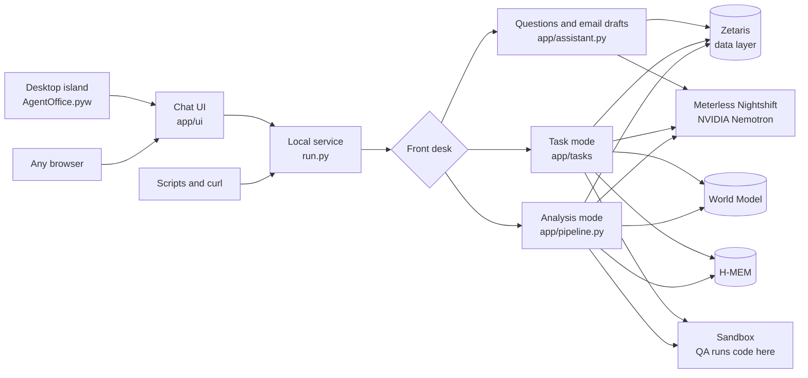
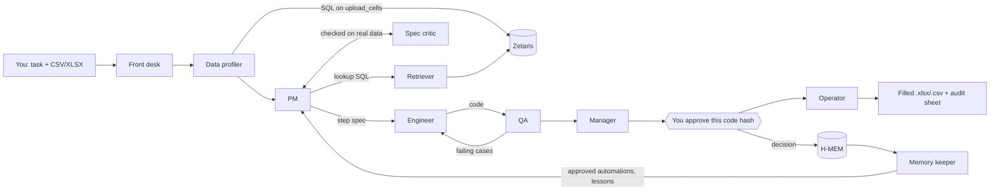
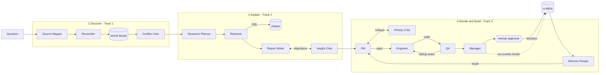

# How AgentOffice works

- [The pieces](#the-pieces)
- [Task mode: "do this to my spreadsheet"](#task-mode-do-this-to-my-spreadsheet)
- [Analysis mode: "where is our time going?"](#analysis-mode-where-is-our-time-going)
- [Questions and email drafts](#questions-and-email-drafts)
- [Why QA can't simply agree with the code](#why-qa-cant-simply-agree-with-the-code)
- [Sponsor technology inside](#sponsor-technology-inside)
- [Sample mode and fallbacks](#sample-mode-and-fallbacks)
- [Data and privacy](#data-and-privacy)
- [Design boundaries](#design-boundaries)
- [Repository map](#repository-map)

## The pieces



- **The local service** ([`run.py`](../run.py)) is a FastAPI app on `0.0.0.0:$PORT`. It serves the chat UI and the [HTTP API](API.md). Each chat message becomes a background job ([`app/jobs.py`](../app/jobs.py)) whose agent events the UI streams live.
- **The front desk** ([`app/chat.py`](../app/chat.py)) routes each message to task mode, the analysis pipeline, a question, an email draft or a plain reply.
- **The desktop island** ([`scripts/island.py`](../scripts/island.py), started by [`AgentOffice.pyw`](../AgentOffice.pyw)) opens the same UI in Microsoft Edge or Google Chrome app mode, with its own profile under `state/island-browser`. It removes the window's frame and taskbar button, keeps it on top, and clips it to a pill or a rounded panel at the top of the screen. The panel is 960 px wide with the Team and Sheet pane beside the chat, or 480 px when you hide that pane (the button next to Enlarge; the choice is remembered). A global hotkey (Ctrl+Shift+Space) focuses it. It uses only Python's standard `ctypes`.
- **The Team and Sheet pane** ([`app/ui/app.js`](../app/ui/app.js)) is drawn only from real trace events: the Team canvas lights each agent, handoff and critique as it happens, and the Sheet grid applies the Operator's `cell_writes` events (old value, plan step, code hash). A past run on the same machine can be replayed from its own trace in `logs/`, with its hash chain checked.
- **Adapters** ([`app/adapters/`](../app/adapters/)) wrap every external call with a timeout, bounded retries and a structured error.

## Task mode: "do this to my spreadsheet"



1. **Upload.** The file is parsed (CSV or XLSX, up to 5 MB or 20,000 rows; Excel dates become ISO text) and served to Zetaris as the REST table `upload_cells`, one row per cell.
2. **Profile.** The Data Profiler queries the upload *through Zetaris*: blanks, numbers and distinct values per column, the exact values of small columns, and value shapes. Personal-looking values (names, emails, phones) are masked before any prompt.
3. **Plan.** The PM turns the sentence into a **step spec** from a fixed vocabulary ([`app/tasks/spec.py`](../app/tasks/spec.py)): `clean_text`, `fill_blank`, `map_values`, `lookup` (from a Zetaris table via SQL, or from another sheet), `compute`, `concat`, `split`, `format_date`, `flag`, `filter`, `dedupe`, `sort` and `summarize` (a new sheet). The Spec Critic checks the spec against the real file and data: every column exists at that step, the lookup SQL runs on Zetaris and its keys actually match the file, and every date matches an input format. Rejections go back to the PM (2 rounds).

   Lookup and dedupe keys are normalised before they're compared: `strip`, `upper`, `lower`, `collapse_spaces` and `digits_only`, plus four normalisers for Arabic-script data. `arabic_digits` turns `٠١٢٣` and `۰۱۲۳` into `0123`; `arabic_text` folds أ, إ, آ to ا, ى to ي and ة to ه, and drops diacritics and tatweel; `arabic_separators` turns ٫ and ٬ into `.` and `,`; `arabic_names` folds common Gulf given names written in Arabic or in Latin spellings (محمد, Mohammed, Muhammad, Mohd) to one key. `format_date` also reads Arabic month names and Hijri dates (civil calendar), and the `parse_amount` step turns `د.إ ١٬٢٥٠٫٥٠`, `ر.س 640` or `AED 1,234.50` into numbers. QA tests Arabic and Hijri dates only on a date column that holds Arabic text, so English sheets are never held to them. The Data Profiler notes when a column holds Arabic digits, script or separators. If a lookup's keys only match the reference once an Arabic normaliser is added, the Spec Critic rejects the plan and names the normaliser, and QA swaps digits, spellings and separators in its mutation and edge cases.
4. **Build and test.** The Engineer writes a standalone Python module from the spec. QA computes the expected output with an **independent reference runtime** ([`app/tasks/runtime.py`](../app/tasks/runtime.py)) and runs the code in the sandbox on:
   - real rows from your file, and your whole file
   - single-cell mutations of every input column (blank, spaces, case, numbers typed as text)
   - edge cases for each step: lookup misses and duplicate keys, date formats, thresholds, duplicate rows typed differently, blanks in sorts and groups
   - model-designed cases, and a determinism re-run
   - a **renamed column, which must raise**

   Failing cases go back to the Engineer (3 revisions).
5. **Decide.** The Manager writes the memo behind a rule gate and requests approval bound to the code hash. The approval card shows the plan, the QA results and a preview of your file after the change.
6. **Run.** Approving runs exactly that code on your file. It writes an `.xlsx` (plus a `.csv` for CSV uploads) with the result sheet, any summary sheets and an **AgentOffice** sheet recording the approver, approval ID and code hash. Nothing is written before approval.
7. **Remember.** The approval becomes an H-MEM memory. Next time the PM can reuse that automation; QA re-tests it on the new file, and because the code hash matches an approval on record, it runs without asking again.

## Analysis mode: "where is our time going?"

You ask a question such as *"Where is the finance team losing time, and what should we automate first?"*. Thirteen agents with distinct roles then work in three stages. They all read from and write to one shared **World Model**, and they carry lessons and human decisions from one run to the next in **H-MEM**.



| Stage | Agent | What it does | Model call? |
|---|---|---|---|
| 1 Discover | **Source Mapper** | Picks tables and join keys from the catalog, then probes each table | yes |
| | **Reconciler** | Links the same task across timesheets, tickets and activity routines, and writes people (by ID only), teams, tasks, tools and their links | yes |
| | **Conflict Critic** | Reads the conflicts the World Model surfaces (sources that disagree about the same fact) and judges which source to trust for what | yes |
| 2 Explain | **Research Planner** | Splits the question into 2–4 sub-questions | yes |
| | **Retriever** | Writes one guarded, read-only SQL query per sub-question. SQL errors go back to the model to fix (a bounded tool-use loop) | yes |
| | **Report Writer** | Drafts claims and must cite the exact result cell behind every number | yes |
| | **Insight Critic** | Checks every citation against the returned rows, plus a model wording review. Objections go back for revision, and unsupported claims are dropped | yes + rules |
| 3 Build | **PM** | Ranks the mined routines by hours saved versus risk and writes a structured automation **spec** | yes |
| | **Priority Critic** | Rejects claims above the hands-on time the activity log measures, and risk ratings below the evidence | rules |
| | **Engineer** | Writes Python from the spec, and revises using QA's failing cases | yes |
| | **QA** | Tests the code in a sandbox against expectations **computed from the spec, never from the code**, plus model-designed cases and an advisory code review | yes + rules |
| | **Manager** | Writes the decision memo behind a rule gate, then requests human approval bound to the exact code hash. It never re-submits code a human already rejected; it escalates instead | yes + rules |
| memory | **Memory Keeper** | Recalls memories for each candidate routine at the start of the build stage, passes the human decisions on record to the PM and Manager, and mines the run's events (QA verdicts, critiques, trust decisions, outcome) into H-MEM | yes |

The loops are real and capped:

- Priority Critic → PM: 2 rounds
- QA → Engineer: 3 revisions
- Insight Critic → Report Writer: 2 rounds
- Retriever SQL fix: 3 attempts
- model calls: at most 40 per run

Every step is written to `logs/trace-<run_id>.jsonl`, a hash-chained log in which any edited or deleted line breaks the chain.

## Questions and email drafts

For the everyday asks around that work: *"Who are the AP clerks in finance?"*, *"How many invoices in my file are overdue?"*, *"Draft an email to the finance team about last week's hours"*. They follow the same rule as the rest of the product: every fact comes from Zetaris rows (or the attached file, through `upload_cells`) or from your own message, and a critic checks it ([`app/assistant.py`](../app/assistant.py)).

1. **Plan.** The Assistant lists the facts the request needs as 0 to 3 sub-questions (0 for a general email that needs no data).
2. **Look up.** The analysis Retriever writes one guarded, read-only SQL query per sub-question and runs it on Zetaris, fixing SQL errors in its capped loop.
3. **Write.** The Assistant writes the answer or the email from those rows only. Personal values in the rows (names, emails, phones) reach the model as placeholders like `[[P1]]`, and are filled back in locally afterwards, so the model never sees them.
4. **Check.** The Grounding Critic's rules object to any number the rows or your message don't support, any placeholder that wasn't issued, any address that isn't in the data or your message, and any email recipient that isn't a person from the rows or your request (an ID such as `P001` is sent back). Once the rules pass, a model review checks each statement against its rows: the right figure for the right week, person or category, and ties and groupings as the rows show them. A query result cut off at 30 rows is marked `truncated`, and both the writer and the review are told it is incomplete. Objections go back to the Assistant (2 rounds); if any remain, the card says so instead of hiding them.

**Nothing is sent.** An email is a draft with a Copy button. These two intents need the model, so in sample mode they return `agent_needs_model` rather than a canned reply.

## Why QA can't simply agree with the code

The PM writes the automation as a spec in a small DSL, not as free text: a record matcher with key normalisation, ordered checks and statuses ([`app/automation/spec.py`](../app/automation/spec.py)). The spec has exact semantics, so QA builds its expected outputs from the spec alone ([`oracle.py`](../app/automation/oracle.py)):

- every status branch, plus check precedence
- key-normalisation variants (case and whitespace)
- empty and ambiguous keys
- values just inside and just outside numeric tolerances
- seeded random mixes
- a **renamed column**, which correct code must reject loudly

It then runs the code in a sandbox ([`sandbox.py`](../app/automation/sandbox.py)):

- An AST policy allows only whitelisted standard-library imports, with no `eval`, `open`, reflection or dunder access.
- The code runs in a `python -I` subprocess with an **empty environment** and a timeout.

Task mode works the same way, with the step runtime as its reference.

## Sponsor technology inside

The submission-form version, with the tests that prove each part, is in [SPONSOR_TECH.md](SPONSOR_TECH.md).

### Zetaris (data layer)

All agent SQL goes through [`app/adapters/zetaris.py`](../app/adapters/zetaris.py). It follows the REST contract (`/sql-editor/sqls/run`, a Bearer key, `X-Org-ID` and a fresh UUID `X-Request-ID`), sends one statement per call, and retries only read-only statements, with timeouts and structured errors.

Zetaris can't read local files, so the service serves each synthetic table as JSON (`GET /data/workforce/<table>`) and every recent upload as long-format cells (`GET /data/uploads/cells`). [`scripts/load_zetaris.py`](../scripts/load_zetaris.py) registers those endpoints as **Lightning REST tables**.

The agents write `workforce.<table>`. The data adapter ([`app/data.py`](../app/data.py)) rewrites each reference to read its REST table, `(SELECT r.* FROM workforce_api.<table> LATERAL VIEW explode(rows) AS r)`, so no views or other extra objects are needed. The trace records the SQL that actually ran.

Verified on a local Zetaris 2.4.3 install:

- All 7 statements succeed, and every workforce row count matches the generator's manifest.
- A file is queryable through Zetaris the moment it's uploaded (Zetaris re-reads `upload_cells` at query time).
- The analysis pipeline's 15 queries run on Zetaris, and the findings are identical to sample mode.

### Meterless Nightshift (Power rule)

Nightshift is the **primary model provider** ([`app/adapters/meterless.py`](../app/adapters/meterless.py)). Every agent calls the model through one injected generator ([`app/llm.py`](../app/llm.py)). The adapter follows the provider contract:

- provider `meterless` / "Meterless Runtime"
- pasted URLs normalised to `<host>/v1`, and the `rt-local` placeholder rejected
- a `meterless-app` header on every request, and `meterless-scope: user` on chat
- status from `GET /v1/models` (online, unauthorized or offline)
- auto-detect across ports 8088, 8090, 8787 and 11434
- connect links (`/connect#k=`)
- a 180-second timeout

Test the connection with `GET /providers/meterless` or `scripts/check_connections.py --detect`.

### World Model engine (Build rule)

[`app/engines/world_model/`](../app/engines/world_model/), written from scratch in Python following the Meterless reference design:

- content-hash stable IDs (`ent_` + sha256 of `type:normalized name`)
- an append-only observation log, with provenance back to source rows required
- a 10-step idempotent ingest: reconcile → cluster → persist → score → infer → edges → views → patch source items → aggregates → mark stale
- canonical reconstruction (latest, union, longest text, most confident, provenance-weighted)
- merge proposals that are never applied automatically
- a structured, budgeted context builder

Every analysis stage reads its context from it and writes what it learns back. Stage 1's source conflicts *are* the World Model's conflict records. Task mode records each spreadsheet, automation and their link. 18 tests cover the engine, including: re-ingest yields an empty diff, resume after a crash, and 10 concurrent writers match a serial run.

### H-MEM engine

[`app/engines/hmem/`](../app/engines/hmem/), written from scratch following the Meterless H-MEM reference contract:

- **Records:** the reference fields, the four types (personal, factual, preference, general) and the three layers (short_term, working, long_term). A record with no source is rejected by construction.
- **Approval boundary:** a programmable `ApprovalPolicy` decides which proposals become durable memory.
- **Reinforcement:** proposing the same memory again raises its confidence by 0.05 and promotes it one layer.
- **Conflicts:** detected by opposing phrases, conflicting numbers or divergent claims about the same entity. They're auto-resolved only at decision confidence ≥ 0.70; the loser gets `supersededBy` and is never deleted. Anything less certain is tagged for human review.
- **Retrieval:** the reference's 8-signal formula, `clamp01(0.35 semantic + 0.20 keyword + 0.10 tag + 0.10 domain + 0.15 entity + 0.05 layer + 0.05 recency − 0.20 superseded) × confidence`, with a 0.35 threshold and the top 5, each returned with a `retrievalReason`.
- **Audit:** an append-only, hash-chained trust ledger in `logs/hmem-ledger*.jsonl`.

What it changes: when a human rejects an automation, the next run proposes a different routine. If there's no alternative, the Manager escalates the identical rejected code instead of asking again. The Engineer's prompt carries QA lessons from earlier runs. 16 tests cover the engine, including this three-session behaviour: learned → retrieved → behaved differently.

### NVIDIA

Nemotron runs through Nightshift lanes; no local GPU is used.

**Speed: three lanes, plus parallel QA.** Each agent call names a lane ([`RunContext.lane`](../app/agents/base.py)):

| Lane | Model | Used for |
|---|---|---|
| **fast** | Nemotron 3.5 Lightning, thinking off | Short structured jobs: routing, QA test design and code review, the Manager's memo, memory mining |
| **draft** | Lightning, thinking off (same as fast) | The PM's first plan. With thinking on, Lightning took longer than Ultra on a full plan, so it is off here too |
| **deep** | `METERLESS_MODEL` (Nemotron 3 Ultra) | The Engineer's code, plus every escalation: a plan the Spec Critic rejected, a draft plan that never validated, or a fast-lane call that failed (e.g. an empty response). Each escalation is traced |

We measured the code lane live. Lightning's code broke the sandbox's size and `global` rules or the spec, and the extra QA rounds cost more than the fast draft saved, so code stays on Ultra.

- QA designs its test cases from the spec alone, so it does that in a thread while the Engineer writes the code. The tracer and the run's model-call cap are lock-protected, so the hash chain stays ordered.
- If the provider answers 404 for the chosen model, the call is retried once on `METERLESS_FALLBACK_MODEL` (traced as `model_fallback`). Nightshift's route sometimes picks Nemotron 3 Super, whose NVIDIA endpoint currently returns 404.

The earlier live runs pinned `METERLESS_MODEL=meterless/deep`, which Nightshift routed to **`nvidia/nemotron-3-ultra-550b-a55b`** (and, for 2 or 3 calls in each analysis run, to `nvidia/nemotron-3.5-lightning-30b-a3b`); every model call's trace records the model that actually answered. Nemotron reasons before it answers, so replies are stripped of their reasoning and get an 8,000-token budget. A reply cut off at the length limit is detected (`finish_reason: length`) and retried with a request for compact JSON.

## Sample mode and fallbacks

`SAMPLE_MODE=true` (or `options.sample_mode`) loads the committed synthetic CSVs into SQLite under the same `workforce` schema name, so the agents' SQL runs unchanged. In this mode:

- Every Zetaris call is logged as `zetaris: skipped (sample mode)`.
- No model is called. Each agent uses its own deterministic, data-driven fallback, logged as `model: offline-fallback`:
  - The PM ranks by measured hours and uses a built-in spec template.
  - In task mode the PM uses a demo file's built-in spec. **For any other file it runs a rule-based planner** ([`app/tasks/offline_planner.py`](../app/tasks/offline_planner.py)):
    - It cuts the request into clauses.
    - It maps each clause to one step type, using the file profile's real column names, types and values.
    - It keeps only steps that pass `validate_spec`.
    - It lists unmapped clauses under *assumptions* and never guesses them.
    - If the Spec Critic rejects a step, it drops that step and resubmits the plan.
    - With no clause mapped, it returns `agent_no_offline_plan` with the phrasings it understands.
  - The Engineer compiles the spec. In task mode it embeds the reference runtime, so QA passes by construction; the trace says `compiled from the spec (offline)`.
  - The writer cites cells from fixed queries, and the front desk routes by keywords.
  - Questions and email drafts have no offline fallback: they return `agent_needs_model`.
- QA, the rule checks of the Priority and Insight Critics, the sandbox and the World Model run exactly as in default mode.

Sample mode returns no saved answers.

## Data and privacy

All the bundled data is **synthetic** and generated by committed, deterministic scripts; see [data/README.md](../data/README.md). The people and events are invented, and emails use `example.com` and `example.org`.

- In analysis mode, agents refer to people by `person_id` only, and a test checks that no name reaches any prompt.
- In task mode the file is yours: values in personal-looking columns (names, emails, phones) are masked to their shape before any prompt, and the model only ever sees the profile, a masked example row and the spec.
- The Sheet pane's cell events in the trace mask the same columns; the finished result shown in the UI keeps the real values, like the output workbook.
- Questions and email drafts send personal values to the model only as `[[Pn]]` placeholders; a test checks that no name or address reaches a prompt.

## Design boundaries

- **Task mode covers spreadsheet work the step vocabulary can express** (fill, look up, tidy, map, compute, split and join, dates, flag, filter, dedupe, sort, group totals). If a request needs more, the PM does the closest useful part and lists what it left out under *assumptions*. It doesn't write formulas into cells or keep the original file's formatting; the output is a clean workbook.
- **Live runs take a few minutes.** With the lanes above, a measured expense-claims run took 242 s. About 190 s of that was Ultra writing the code, and every other model call took 1 to 28 s. Before the lanes, a run took 5 to 10 minutes. Each QA rejection adds an Ultra revision of a few minutes. The UI shows each step as it happens. Nightshift may hold a reply until it's complete, so model calls wait up to 600 s.
- **Uploads are kept** under `state/uploads/` (git-ignored) so Zetaris can read them. Delete that folder to remove them.
- **The sandbox on Windows** has no memory limit (no `rlimit`), so the timeout and the static AST policy are the guards there. POSIX and Docker add CPU and memory limits.
- **The Priority Critic** treats the hands-on time measured in the activity log as the ceiling on hours saved. That's conservative, and it's an assumption.
- **Confidence** comes from a stated heuristic formula (shown in each response), not from calibrated probabilities.
- **Token budgets** use the `ceil(chars / 4)` heuristic.
- **The Insight Critic** accepts a number only if it equals a cited value, or a ratio or percentage of two cited values. Integers up to 10 always pass. Other derived numbers must be computed in SQL.
- **The Grounding Critic** accepts a number in an answer or email if it is written in any result cell or in your message (date parts included), or is a ratio or percentage of two numeric cells. Integers up to 10 always pass, so a small wrong count can slip through the rules. Whether a figure is tied to the right week or person is judged by the model review, which is a second opinion, not a proof; if that call fails, the run continues on the rule checks alone and the trace says so.
- **World Model aliases** apply to mentions made after they're registered. Similar names become merge proposals and are never merged automatically.
- **Agent SQL** must stay within a portable subset (documented in `app/data.py`) so it runs on both Zetaris and SQLite. One difference is taught explicitly: `/` gives a decimal on Zetaris even between whole numbers (SQLite gives a whole number), so agents wrap whole-number results, such as a week of the month, in `CAST(... AS INTEGER)`.
- **H-MEM's semantic signal** is the cosine of hashed bag-of-words and bigram vectors, not a neural embedding, so no embedding model is needed. Paraphrases with no shared words score low.
- **Mined lessons** start as `short_term` at confidence 0.6 to 0.8, so they usually fall below the 0.35 retrieval threshold until they're reinforced across runs. Human decisions are `long_term` and are always applied, by exact lookup rather than by ranking.
- **Not built yet:** the desktop island on macOS and Linux (the browser UI works there), scheduled runs of approved automations on new files, and H-MEM dreaming and sleep consolidation (layers are promoted only by reinforcement).

## Repository map

```
run.py              the local service: FastAPI on 0.0.0.0:$PORT, the chat UI and the API
AgentOffice.pyw     the Windows desktop app (hidden service + island)
setup.ps1           one-time setup on Windows
app/adapters/       zetaris.py, meterless.py, http.py (timeouts, bounded retries, structured errors)
app/engines/world_model/   Meterless World Model engine (store, 10-step ingest, context builder)
app/engines/hmem/   Meterless H-MEM engine (store, approval policy, conflicts, retrieval, mining, trust ledger)
app/agents/         base.py (traced model and data calls), stage1.py, stage2.py, stage3.py, memory.py
app/automation/     analysis-mode spec DSL, QA oracle, offline compiler; sandbox.py (shared)
app/tasks/          task mode: spec.py (step vocabulary), runtime.py (reference semantics = QA oracle),
                    qa.py (cases, comparison, offline compiler), files.py (CSV/XLSX in and out, upload store),
                    agents.py (front desk, profiler, PM, critic, retriever, engineer, QA, manager, operator),
                    pipeline.py (plan -> build -> test -> approve -> run)
app/ui/             the chat island (index.html, style.css, app.js; no build step)
app/assistant.py    questions and email drafts: plan, retrieve, write, Grounding Critic
app/chat.py         one chat message -> one background job, routed to task, analysis, question, email or reply
app/jobs.py         background jobs with live trace events for the UI
app/services.py     stores shared by the API and the jobs
app/analysis/       routine mining from the activity log
app/data.py         data-layer seam (Zetaris or sample SQLite), including upload_cells
app/approvals.py    hash-chained human approval ledger
app/pipeline.py     the three-stage analysis run
scripts/            island (desktop), install_shortcut, check_connections, load_zetaris,
                    generate_workforce_data, generate_task_samples, run_examples, build_deck
data/sample/        synthetic workforce tables and demo spreadsheets
input_examples/     analysis questions for POST /run
output_examples/    real responses and traces saved from runs (never read by the app)
docs/               SETUP, API, ARCHITECTURE, SPONSOR_TECH, INSPIRATION, the deck and images
tests/              pytest suite
```
